# 청송사과즙은 노출 확대와 함께 가격·상품 신뢰를 준비해야 합니다

2026-10-27 종합 분석 · 삼형제농원 사과즙 11659930652 · 11월 수확 후 판매 준비

## 핵심 결론

- **사과즙 수요를 겨냥할 여지가 있습니다.** 현재 키워드도구의 월간 통합검색수는 `사과즙` 8.61k회, `청송사과즙` 700회입니다. 필수 표현 **청송사과**를 유지하면서 사과즙의 용량·포수·산지를 명확히 하는 방향입니다. 검색수는 쇼핑 주문이나 시장점유율이 아닙니다.
- **관찰한 경쟁 8개보다 가격이 높습니다.** 120ml·50포 일반배송 포함 28,000–30,500원에 비해 우리 상품은39,900원으로 약31–43% 높습니다. 원재료·제조·품질이 동등하다고 확인한 비교는 아니므로, 무조건 할인하기보다 차이를 설명할 실물·제조 증빙과 구성안을 먼저 준비해야 합니다.
- **과거 광고는 규모가 작고 순주문 검증이 없습니다.** 86.0k노출·348클릭·광고비26,664원·전체전환10건입니다. 2026년1–5월에8건이 관측돼 11월만의 판매 상품으로 볼 근거가 부족합니다. 전체전환은 귀속 이벤트이며 취소·반품 후 주문이나 팩 판매량이 아닙니다.
- **첫 문구 시험을 실제 가동했습니다.** 10/27 22:06경 기존A의43노출·0클릭을 보존해 일시중지하고 심사통과한B 청송사과즙120ml만 ON으로 전환했습니다. B첫실제노출/효과는아직미확인입니다. 현재 상세의 소비기한 충돌·1인1개 제한·즉시출고 표시는 출시 직전 실제 출고 조건과 대조할 우선 항목입니다.
- **증분 판매 개선이 입증된 액션은 아직 없습니다.** 순판매팩수와 광고 후 기여이익을 공통성과로 두고, 측정·출고정보·원가를 갖춘 뒤 첫화면 또는한가지혜택을검증합니다. 아래에실험명세·태스크8개·의사결정기준을추가했습니다.

## 실제 계정에 등록한 첫 문구 시험 — J-COPY-01

2026-10-27 사용자 #56의 즉시 테스트 요청에 따라, 기존 광고그룹에 **문구1만 다른 B안**을 실제 등록했습니다. B의 심사가 통과해 한국시간22:06경 **A 일시중지 / B 단독ON·운영가능**으로 전환했습니다. 시험 설정은 가동됐지만 B의 첫 실제 노출·성과는 아직 확인되지 않았습니다.

| 항목 | A: 기존안 | B: 등록한 시험안 |
|---|---|---|
| 문구1 | 청송사과즙50포 | **청송사과즙120ml** |
| 문구2 | 청송사과즙 120ml 50포, 삼형제농원 | 동일 |
| 확인 상태 | 중지: 확장소재 OFF, 원본/실적 보존 | 운영 가능, 단독 ON |
| 변경 직전 조회 | 10/21–27:43노출·0클릭·0원 | 등록 직후0노출·0클릭·0원 |

수량 강조와 팩당 용량 강조의 클릭 반응을 관찰하는 후보입니다. 필수 **청송사과**는 양쪽에 유지했습니다. 기존 광고 제목·상품·가격39,900원·입찰100원(VAT별도)·콘텐츠입찰100원·그룹일예산10,000원·매체는 유지했습니다. 새 캠페인이나 충전·예산 증액은 없습니다. 기존 일예산은 새 시험의 총승인예산을 뜻하지 않습니다.

기존 A의 실적과 원본은 남기고 일시중지했습니다. B만 운영가능/ON임을 확인했고, 다음은 실제 첫노출 확인입니다. **전후 순차 관찰**이지 인과효과를 추정하는 무작위 A/B가 아닙니다. 넓은 광고영역에 쓰는 문구2는 같아 차이가 희석될 수 있습니다.

**측정 규칙:** B의 첫 실제 노출 확인 후 첫3개 완료일을 점검 단위로 둡니다. 전환/승인 경계일·심사대기는 비교에서 빼고, A의과거구간과 B의후속완료일에서 가능한 같은 지면·가격·출고조건의 노출·클릭·CTR을 봅니다. 두 시안은 동시 비교가 아니며 계절·시간 차이가 남습니다. A누적43회와 B신규기간총계를 그대로 비교하지 않습니다. 표본이 적으면 판정유보하며, 클릭 상승을 판매 증가로 바꾸지 않습니다. 잘못된 표시·거절·출고/손실 문제가 확인되면 B중지 후 보존된A복원이 복구 경로입니다. 심사통과·단독운영은22:06경확인,실제첫노출시각과첫관찰결과는미확인입니다. 자동조회예약은설정하지않았습니다.

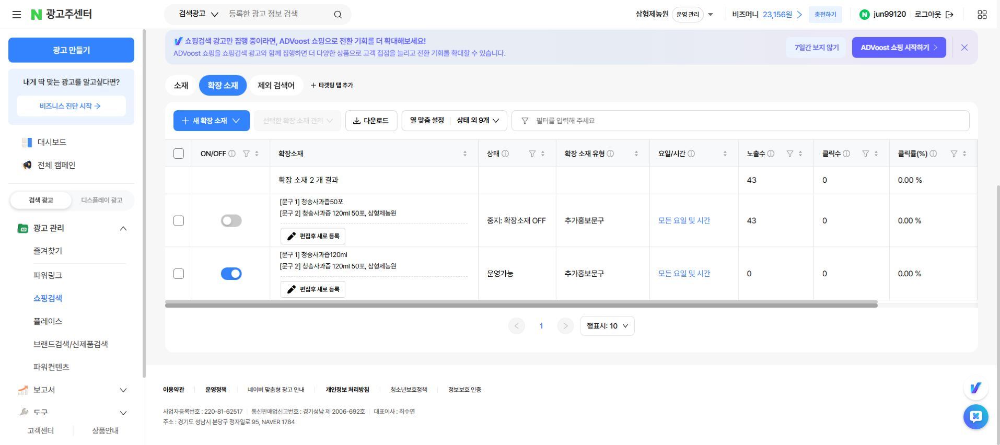

[시험명세·기준선·실제화면기록](juice_trial_2026-10-27.json)


## 광고안: 청송사과즙의 구성·간편함·총용량을 각각 전달합니다

**10/28 거시·식품·키워드 진단 및 실제시험 갱신:** [클라이언트 시각화자료](juice_client_visual_2026-10-27.html) 상단에 광고유형별역할·식품연구·364개키워드정제·119개카드관찰·6개실제진단과 새제목시험을추가했습니다. ‘청송사과’ 단독과‘사과주스’는 현재소재 카테고리연관성부족으로광고불가진단. 필수‘청송사과’를‘청송사과즙’구매의도에연결합니다. 광고명은 ‘청송사과즙 얼음골 사과하나 120ml 50포’(24자)로저장, 가격/입찰/예산/사진유지. 이전B의작은규격표현변경은판매전략핵심근거로사용하지않습니다. [키워드전체표](juice_keyword_priority_2026-10-28.csv),[검토집계](juice_market_reviewed_2026-10-28.json),[진단](juice_diagnostics_2026-10-28.json),[시험기록](juice_title_trial_2026-10-28.json). 아래3개포스터와10/27시험수치는과거시안/스냅샷입니다.

| 10/28 추가 검증 | 결과와 실행 판단 |
|---|---|
| 키워드 550행 → 중복제거 364개 | 사과즙 8,690 / 청송사과즙 710 / 얼음골사과즙 470 / 사과즙50포 450. 월간 PC+모바일 통합검색 수로, 쇼핑 구매량이 아님. |
| 실제 소재 6검색어 진단 | 청송사과즙·사과즙50포·사과즙은 노출요건 충족. 청송사과·사과주스는 카테고리 연관성 부족. 청송얼음골사과즙은 판정 유보이며 제목 변경 직후 재진단도 동일. |
| 12검색 72카드 + 플러스 47카드 | 중복 포함 119회 관찰. 72개 중 광고 52개에서 무료배송47·구성/수량44·원료/공정21·오늘출발15·교환반품14개 확인(중복 집계). 성공 원인이나 시장 노출점유율 아님. |
| 가격 검증 범위 확대 | 새 광고 카드에 120ml50포 배송 포함 24,900원·27,900원. 최종 옵션/결제 미검증. 29,900원 제안을 최저가라고 설명하지 않음. 실제 판매가 변경 보류. |
| 제목 시험 J-TITLE-02 | 새 제목 저장 및 **운영 가능** 확인. 변경 전 전체 소재 10/21–27: 623노출·1클릭·110원(VAT포함)·전환0. 새 제목 실노출/판매 효과 미확인. 순차 관찰형이며 무작위 A/B 아님. |

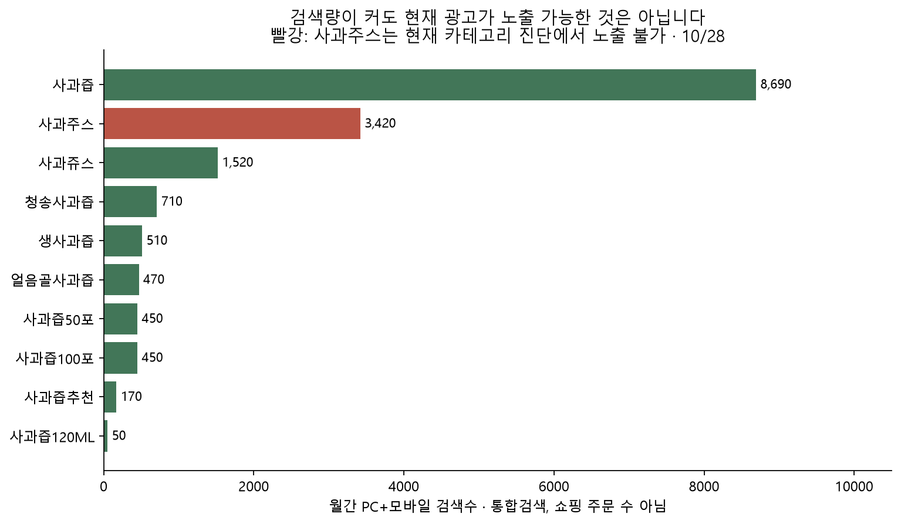

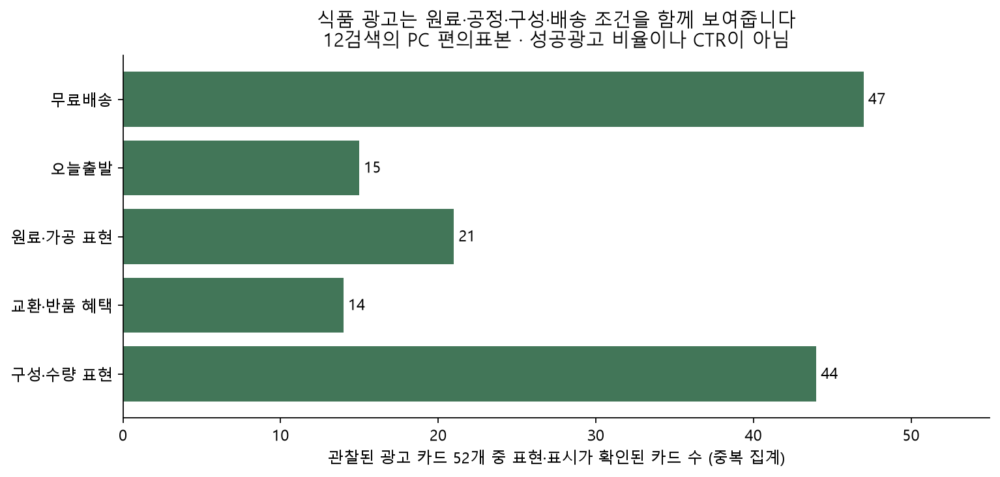

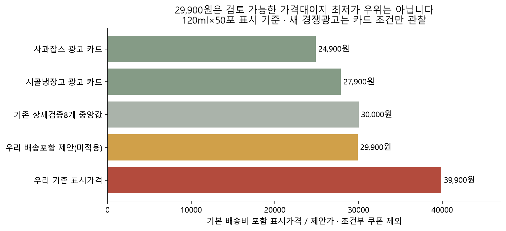

쇼핑 상품형은 상품정보에 따라 자동 매칭하며 키워드 직접 등록을 지원하지 않습니다. 키워드 표는 상품정보·실제 유입·제외 여부를 검토하는 입력입니다. [네이버 매칭 기준](https://ads.naver.com/help/faq/1433). 노출 순위는 입찰과 품질·관련성을 함께 보므로 제목 변경이 순위 상승을 보장하지 않습니다. [노출 순위 기준](https://ads.naver.com/help/faq/253).

식품 확장 후보는 ADVoost와 쇼핑검색의 조합이지만, 네이버의 104주 패널 회귀 연구는 우리 상품의 예상 매출 증가율이나 무작위 실험 결과가 아닙니다. 출고·전환 추적·원가·손실한도를 확인한 뒤 별도 시험합니다. [네이버 D광고리포트2025 p8·p16](https://www.navercorp.com/api/article/download/7891e840-366c-4922-9b37-2f8a29903b93). 현재 신규 캠페인은 생성하지 않았습니다. 다음 관찰은 제목 교체 경계일을 제외한 첫 완전 노출일 이후 완료3일 점검이며, 표본이 작으면 효과 판정을 유보합니다.

**#62 가격 하한 확인:** 24,900원은 친구가 가능한 상품 판매가의 최저 하한입니다. #61 배송비 별도 조건은 유지하며 원가·배송 포함 하한으로 해석하지 않습니다. 상품 할인/판매자 부담 쿠폰으로 이 하한을 밑도는 안은 제외하고 실제 적용은 보류합니다.

**#61 최신 가격 제안(미적용):** 사용자 전달에 따르면24,900원+배송비별도 또는29,900원배송비포함까지 가능하다고 합니다. 동일120ml50포 전제라면29,900원은포당598원,앞서비교8개중앙값30,000원보다0.3%낮아 기존33%가격프리미엄을설명해야한다는전제가달라집니다. 기존39,900원관측값은과거사실로보존합니다. 별도배송비는미확정이며5,000원이라고추정해확정하지않습니다. 실제가격/출고구성/배송범위/원가확인전설정변경없음. 다음전략은검색명-포장명연결·실제품/제조/출고신뢰를우선하고,가격변경과사진/문구시험을분리해순판매량과공헌이익을확인합니다. 클라이언트HTML상단에계산과조건부원고를추가했습니다.

[실사진 광고 3안·전체 분석을 함께 보는 클라이언트 설명자료](juice_client_visual_2026-10-27.html)

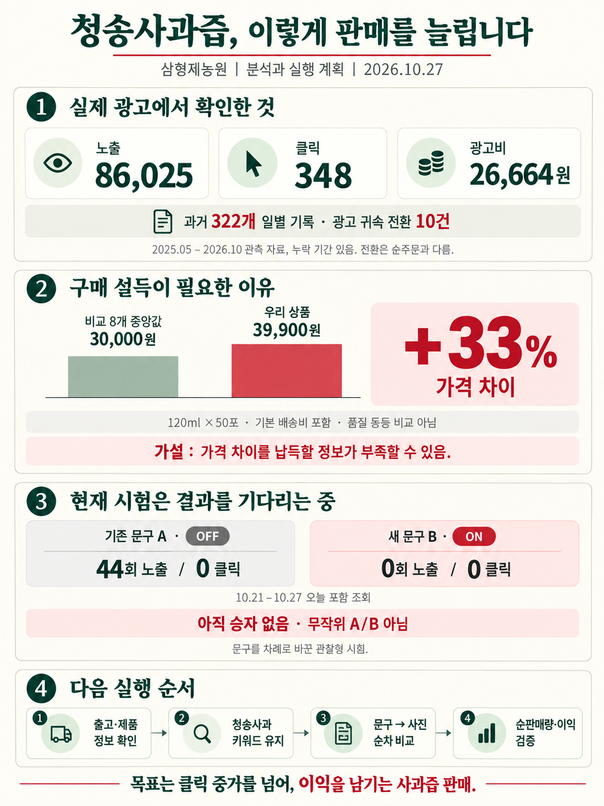

| 1안: 구성 이해 — 기본안 | 2안: 한 포의 간편함 | 3안: 총용량 이해 |
|---|---|---|
| 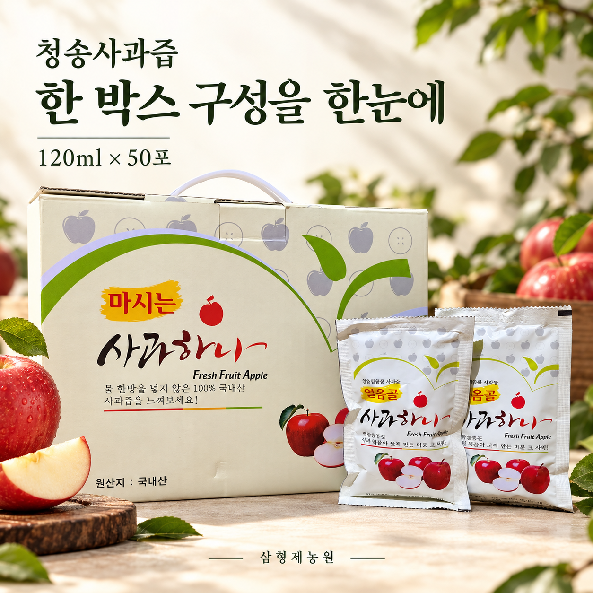 | 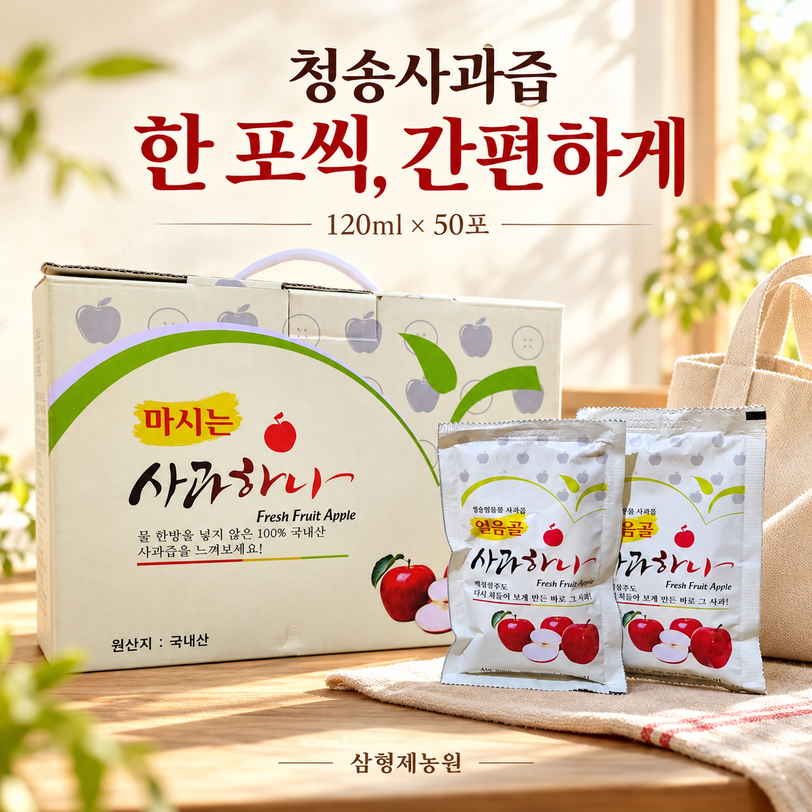 | 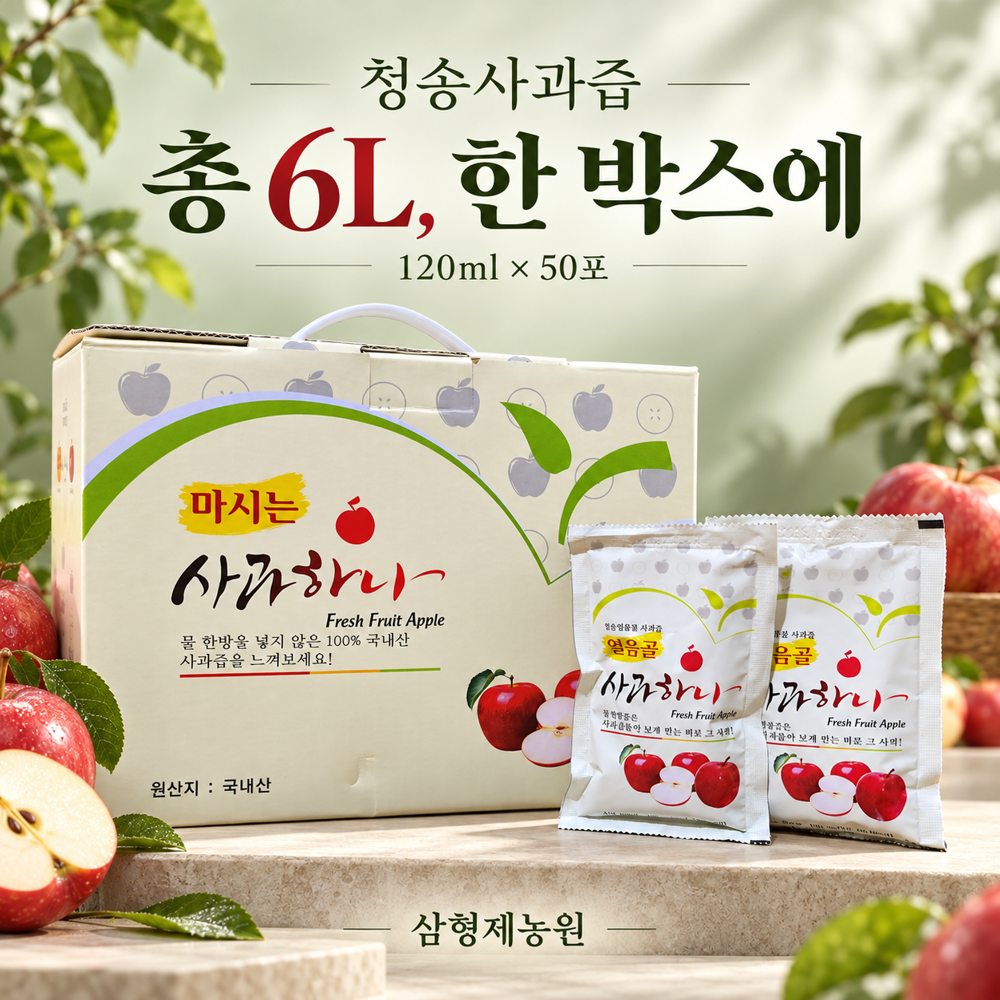 |

사용자 제공 실제 박스·납작한 파우치 사진을 바탕으로 AI가 배경·조명을 구성한 광고 시안3개입니다. 포장 작은 글자는 원본 대비 재검수해야 하며 새 이미지3종은 계정에 업로드하지 않았습니다. 상세페이지·SNS 등 사용처 검토용 문구형 포스터로, 네이버 쇼핑 대표이미지에는 지면 규정을 별도 대조한 제품 중심 원본 사진을 사용합니다. 앞서 만든 [구도 예시 제안서](juice_ad_plan_client_2026-10-27.png)는 이전 참고자료로 보존합니다.

**#60 전략 보완:** 세 이미지의50포·간편함·총6L는 기본 설명이며 확인된 차별점이 아닙니다. 비교 상품도120ml50포이므로 총용량만으로39,900원 대 중앙값30,000원의 차이를 설명하지 못합니다. 현재 시험의50포→120ml 변경도 약한 개입이며 판매전략의 핵심 증거로 삼지 않습니다. 클라이언트HTML 상단에 **검색명과 포장명 연결 / 가격 차이를 설명할 실물 증빙 / 첫구매 부담을 낮출 조건부 제안**으로 구매 장벽별 근거·가설·검증을 보완했습니다. 원산지·제조/소비기한·출고 표시 정합성을 먼저 바로잡고, 검증된 자료가 없는 프리미엄 서사를 만들지 않습니다.

**10/27 재조회:** 오늘 포함10/21–27 확장소재 A는OFF·44노출·0클릭·0원, B는ON·운영가능·0노출·0클릭·0원입니다. 기존43노출 저장값은 당시 사실로 보존합니다. B첫노출 미확인으로 승자·판매증가를 주장할 수 없습니다. 전후 순차 관찰형이며 무작위 A/B가 아닙니다. [재조회 근거](juice_trial_refresh_2026-10-27.json).

대상은 삼형제농원 사과즙11659930652입니다. 세 안의 공통 광고용 상품명은 **청송사과즙 120ml 50포 삼형제농원**(21자)으로 유지합니다. 확인된 현재 표시규격만 사용했고, 새 수확분·제조일·인증·100%·무첨가·즉시출고·효능·가격우위는 새로 주장하지 않았습니다. 11월 실제 출고 구성이 달라지면 문구도 함께 대조합니다.

### 복사해서 쓸 수 있는 쇼핑검색 문구

| 광고안 | 구매자에게 전달할 내용 | 짧은 홍보문구1 | 긴 홍보문구2 | 상태 |
|---|---|---|---|---|
| 1. 규격을 명확히 | 어떤 상품을 몇포 받는가 | **청송사과즙120ml** (10자) | **청송사과즙 120ml 50포, 삼형제농원** (22자) | J-COPY-01의B로실제등록·심사통과·단독ON확인.실제성과미확인 |
| 2. 한 포의 간편함 | 나눠 담긴 음료를 편하게 마시려는 상황 | **청송사과즙한포** (7자) | **청송사과즙 120ml 50포, 한 포씩 간편하게** (26자) | 제안초안.신규등록/운영하지않음 |
| 3. 박스 구성을 명확히 | 전체 구성을 쉽게 비교하려는 상황 | **청송사과즙총6L** (8자) | **청송사과즙 120ml 50포, 총 6L 구성** (24자) | 제안초안.신규등록/운영하지않음 |

첫 구매자/음용상황은 메시지를 설계하기 위한 가설이며, 실제 구매자 세그먼트나 연령별 성과를 측정한 결과는 아닙니다. 총6L는120ml×50포의합계로 단일파우치용량이 아닙니다. 동일규격이 유지될 때만 사용합니다.

광고용 별도상품명25자이내,홍보문구1은10자/문구2는30자이내로 점검했습니다. 짧은문구와긴문구는같은광고영역에항상함께보이는것이아니라 공간에따라하나가노출됩니다. 각문구가단독으로도뜻이통하도록구성했습니다. [상품명기준](https://ads.naver.com/adguide/1014),[추가홍보문구안내](https://ads.naver.com/help/faq/1233)

### 광고 이미지 촬영·제작 지시

아래는 원래 촬영 지시입니다. 이후 사용자 실사진으로 위 시안3개를 제작했습니다. 새 출고 제품의 포장·표시사항·50포 구성이 같은지 확인한 뒤 실제 사용처에 맞춰 검수합니다. 광고 업로드는 하지 않았습니다.

| 광고안 | 정사각 대표사진 구도 | 상세페이지에서 이어줄 장면 |
|---|---|---|
| 1. 규격 | 밝고단순한배경,실제파우치정면과실제판매박스.라벨이읽히고제품이중심에오도록촬영 | 실제50포구성과120ml라벨을확대해보여줌 |
| 2. 간편함 | 같은제품파우치를손에들거나책상위에둔모습.소품보다제품이잘보이도록촬영 | 개봉·음용형태가보이는실제사진.보관방법은실제라벨기준 |
| 3. 총용량 | 판매박스와일부파우치를함께촬영해구성을이해하도록함.실제포장과다른수량연출금지 | 120ml×50포=총6L 구성표와실제박스사진 |

우선640×640px 작업안을 준비하고,사진안에새판촉문구를넣기보다는등록문구란을사용합니다. 왜곡/과도한보정이나실제와다른파우치·포장을만들지않습니다. 공식기준은상품이주된요소여야하며별도이미지는300–2000px범위를안내합니다. 구성설명등일부합성예외가있으므로'모든합성이항상금지'라고일반화하지않고최종이미지별로검토합니다. [네이버상품이미지기준](https://ads.naver.com/adguide/1018)

### 광고를 클릭한 뒤 보일 첫 화면 원고

> **청송사과즙**
>
> **120ml × 50포, 총 6L**
>
> 한 포씩 간편하게 만나는 삼형제농원 사과즙

바로아래에실제박스/파우치사진·판매규격·총결제가격·배송비·정확한출고예정일을배치합니다. 실제제조/소비기한·보관방법·원재료와제조방식은실물라벨확인후같은화면에서찾을수있게합니다. 날짜를임의로채우거나수확일을가공완료일로대체하지않습니다.

### 검색 수요·운영 구조

- 필수 **청송사과**는 모든 상품명/문구안에 유지합니다. 실제 유입은 상품 종류가 맞는 **청송사과즙** 중심으로 확인합니다.
- 구매형관찰후보: 청송사과즙·사과즙50포·사과즙120ml. 후속확장후보: 사과주스·착즙사과즙(착즙은실제제조방식확인시에만). 뒤의후보가실제유입/월간검색수까지검증됐다는뜻은아닙니다.
- 쇼핑검색은상품정보와검색어가매칭되는방식이므로위목록을직접입찰키워드등록목록으로설명하지않습니다. 청송사과단독은기존진단의카테고리연관성제약을고려하며노출을보장하지않습니다.
- 기존1캠페인/1그룹/타깃1상품으로이어갑니다. 현재100원입찰(VAT별도)·그룹하루상한10000원은기존설정이며,이번에새로제안하거나승인된총시험예산이아닙니다. 이광고안작성으로가격/입찰/예산을바꾸지않았습니다.

### 시험 순서와 채택 기준

1. **현재:** J-COPY-01 B의첫실노출과첫완료일지표를확인합니다. 현재시험을중간에새세안으로교체하지않습니다. 현재B는문구1만바꾸는시험이며,위2/3안은문구1/2를함께구성한콘셉트제안입니다.
2. **다음문구:** 노출량과이전시험조건을확인한뒤2번또는3번중하나를선택합니다. 문구1/2를묶어바꾸면콘셉트묶음효과로기록하고어느필드가원인인지분리하지않습니다. 필드별효과가목적이면한필드만바꿉니다.
3. **그다음사진:** 문구/가격/입찰을고정한뒤실물대표사진한가지만교체합니다. 사진과문구를함께바꾼성과를사진단독효과라고하지않습니다.
4. **혜택:** 실제원가·재고·총시험예산확정후한가지혜택을검토합니다. 근거없이최저가/반값/출시특가/무료선물포장을약속하지않습니다.

노출·클릭·CTR은메시지반응을보는진단이고,채택/확대는구매완료·순판매팩수·광고후기여이익으로대조합니다. 주문접근이안되면클릭반응만관찰했다는한계를남깁니다. '3일이면승자결정'이아니라기존시험처럼완료일별데이터와누적표본을함께봅니다.

세안동시등록·새캠페인분할은현재안에포함하지않았습니다. 공식도움말상그룹/소재단위의추가홍보문구등록한도는각2개이며,현재그룹은A/B두개가기록돼있습니다. 후속안의실제등록전기존시험기록보존과등록범위를확인합니다. [공식등록안내](https://ads.naver.com/help/faq/1233)

---

## 성장 실험과 성과 체계: 지금은 효과 검증의 출발 조건을 갖추는 단계입니다

채용 공고의 업무를 이 사업에 적용하면 분석의 단위는 키워드나 그래프가 아니라 **어떤 결정을 바꿀 것인지**가 됩니다. 패션·뷰티의 성공 사례를 사과즙에 옮겨 단정하는 대신, 신규 유입·첫 구매·주문당 수량·재구매라는 성장 경로별로 가설을 나눴습니다. 아래는 새로운 판매 실험의 결과가 아니라, 기존 증거를 재평가한 의사결정과 실행 설계입니다.

### A. 지금까지 한 액션의 효과를 다시 판정하면

| 액션·관찰 | 확인된 것 | 아직 입증하지 못한 것 | 현재 결정 |
|---|---|---|---|
| 광고용 제목+홍보문구 변경 | 저장 완료, 홍보문구 운영 가능·23회 노출 | 원래도 발생했을 노출 대비 증분, 클릭·순주문·이익 증가, 두 변경 각각의 효과 | 실행·노출 확인으로만 기록. 성공 사례로 분류하지 않음 |
| 1–5월 전환8건 | 해당 기간 광고 귀속 이벤트가 존재 | 계절의 인과효과, 특정 전략이 만든 판매 증가 | 연중 판매 검토의 단서. 수확철 집중이 최선이라고 확정하지 않음 |
| 경쟁8개보다 높은 가격 | 관찰한 동용량/포수 제안과 가격 차이 | 가격이 판매 저조의 원인인지, 할인하면 이익이 증가하는지 | 가격/구성 가설의 우선순위 근거로 사용 |
| 외부검색 비용33.3%·전환0 | 시즌 매체 실적의 구성 | 외부검색을 끄면 전체 순주문/이익이 늘어나는지 | 제외 효과를 확정하지 않고 지면별 측정 후보로 유지 |

**현재 자료에서 증분 순주문이나 이익 개선이 입증된 액션은 없습니다.** 비교군·배정·출고 상태·주문 대조 없이 광고 전환이나 전후 차이를 인과효과로 바꾸지 않습니다. 10/19–25와10/20–26은6일 중첩되고 제목과 문구도 함께 바뀌어, 단순 전후 비교의 기준선으로 적합하지 않습니다.

### B. 성과 체계는 순판매팩수와 광고 후 기여이익 두 가지로 고정합니다

| 구분 | 지표와 정의 | 사용 목적 | 필요한 자료·현재 상태 |
|---|---|---|---|
| 주성과1 | **주간 순판매팩수** = 타깃 주문상품의 팩수−취소팩수−반품팩수 | 실제 사과즙 판매량 증가 | 상품/옵션별포수·수량·취소반품 대조 필요. 현재 미확인 |
| 주성과2 | **주간 광고 후 기여이익** = 환불 반영 상품수취액+판매자수취배송비−생산/포장/배송/수수료/추가프로모션/반품 손실−광고비 | 매출만 늘고 손해 보는 확대 방지 | 실제변동비·정산·할인분담 필요. 현재 미확인 |
| 판매량의 원인 | 순주문수 / 순주문당팩수 | 첫 구매 확대와 묶음 효과를 구분 | 타깃 포함 주문ID중복제거,부분취소반품 반영. 50포/100포를 팩수로 통일 |
| 이익의 원인 | 광고 전 주문당기여이익 / 광고비 | 상품제안과 유입비용을 구분 | 반품으로상품이전부남지않은 주문도 비용에서 누락하지 않음 |
| 구매 경험 제약 | 파손·누액/취소반품 / 출고약속 준수 | 품질·배송을 해치며 수량만 늘리는 것을 방지 | 실제접수/출고집계. 표본이적으면 건수와분모를 함께 표시 |

할인·환불이 이미 상품수취액에 반영됐으면 다시 빼지 않습니다. 고정비·세금까지 모두 반영한 순이익을 계산한 것이 아니므로 **기여이익**이라고 부릅니다. 광고비·가격·원가의 VAT 및 정산 기준을 맞춰야 합니다.

순판매팩수·순주문은 한국시간 월요일–일요일의 주문일 코호트로 제안합니다. 취소·반품 반영일과 집계기준일을 남기고 최신 주는 잠정치로 표시합니다. 반품 반영이 끝난 비교기간을 사용하기 전, 실제 지연 분포로 성숙 기준을 확정해야 합니다. 주간광고후기여이익은 같은 주 주문의순기여이익에서 그 주 광고집행비를 뺀 운영용기간지표로 정의하며, 광고클릭코호트의LTV나 인과적광고수익과혼합하지않습니다. 주를넘는전환지연은별도표시하고 실험의그룹별이익은배정코호트와같은관찰기간으로따로계산합니다. 지표가 없는 주는0이 아니라미확인입니다. 타깃11659930652 외 신규구성이 생기면 상품/옵션과팩수 매핑을 먼저 추가합니다.

노출·CTR·CPC·상품방문·광고전환은 원인 진단용입니다. 자연검색과 광고를 분리하며, 전체전환10건을 순주문10건이나 주성과의 기준선으로 쓰지 않습니다. 목표를 지금 '판매량 두 배'로 정하지 않고, 실제 출고 역량·초기 순주문·단위이익을 확인한 뒤 목표량을 잡습니다.

### C. 성장 기회는 세 가지를 먼저 검증하고, 재구매는 그다음에 봅니다

| 우선 | 근거 → 성장 가설 | 첫 실행안 | 구매/이익으로 이어지는지 확인할 지점 |
|---|---|---|---|
| 선행조건 | 소비기한 충돌·출고표시·1인1개 제한 → 신뢰와 구매 가능성 문제일 수 있음 | 실제로트/출고상태로 정보 일치,제한설정의 목적 대조 | 잘못된 정보 수정은 A/B 대상이 아님. 오류를 남겨 비교군으로 쓰지 않음 |
| 1. 첫 구매 설득 | 모바일클릭92.9%,구성/가격 차이 → 첫화면의 증빙을 이해하면 구매가 쉬워질 수 있음 | 확인된 원물·가공·용량/포수·포장·출고를 한 화면에 정리 | 상품방문 이후 구매사용자비율,순팩수,문의·취소·반품. CTR만으로 성공판정 안함 |
| 2. 첫 구매 제안 | 39,900원과 경쟁28,000–30,500원 → 결제부담/차별성 문제일 수 있음 | 50포유지와 소량/혜택 중 실현가능한 한 가지 후보를 손익 계산 | 적격사용자당 순구매·팩수와 할인 후 기여이익. 원가없이 가격 인하부터 하지 않음 |
| 3. 유입의 확장 | 사과즙 통합검색수8.61k,청송사과즙700 → 산지표현을 유지하면서 상품종류 수요를 받을 여지 | 청송사과 필수·사과즙 중심 검색 매칭 진단과 실제 검색어 관찰 | 적합유입·순주문·이익. 검색수/광고노출을 매출예측으로 바꾸지 않음 |
| 후순위. 주문량/재구매 | 일부경쟁100포 옵션·간편음용 용도 관찰 → 묶음/반복 구매 가능성 | 원가/재고 확정 후100포 제안,구매코호트의 반복주문 집계 | 신규50포 매출을 빼앗는지·남은재고·재구매이익. 충분히지난코호트끼리 비교 |

100포 선택자가50포 선택자보다 많이 지출했다는 사실만으로 묶음의 효과라고 할 수 없습니다. 원래 많이 살 고객의 자기선택일 수 있습니다. 콘텐츠도 건강 효능 주장 대신 확인된 산지·가공·포장·섭취 편의의 이해를 돕는 가설로 준비하며, 콘텐츠 방문을 판매 기여로 자동 귀속하지 않습니다.

### D. A/B 테스트는 배정과 측정이 확인될 때만 그 이름을 씁니다

이 계정에서 **안정적인 사용자 단위 무작위 배정·각 버전 노출 이력·주문 연결** 기능은 검증하지 못했습니다. 네이버가 이런 기능을 전혀 제공하지 않는다고 단정한 뜻은 아닙니다. 새 소재2개나 같은상품2개를 만들어 노출이 나뉘었다고 임의로50:50 A/B라고 부르지 않습니다. 실제 쇼핑 광고 노출은 상품 연관도와 입찰 등의 영향을 받습니다. [네이버 광고 노출 안내](https://help.pay.naver.com/faq/content.help?faqId=10891)

| 방법 | 이 사업에서 가능한 조건 | 결과를 설명하는 수준 |
|---|---|---|
| 사용자 단위 무작위 A/B | 플랫폼이 허용하는 동일자격 사용자 배정,버전노출/배정로그·주문연결·유효표본 확보 | 배정된 전체 사용자를 기준으로 비교. 배정/누락/오염을 점검한 뒤 증분효과 검토 |
| 시간 블록 교대 | 사용자 분할 불가 시 충분한 반복블록·요일균형·재고/가격/유입기록·노출/전환지연 통제 | 설계와 자료가 충분할 때만 별도의 시간단위 분석. 단순 월A/화B를 무작위사용자A/B로 해석하지 않음 |
| 한 번의 전후 변경 | 현재처럼 분할/표본이 부족한 상태의 상품 개선 | 관찰형 파일럿. 같은요일/매체/가격/재고를 가능한한 맞추되 계절·시즌효과가 남아 인과효과미확정 |

가격/쿠폰 테스트를 한다면 **쿠폰을 쓴 고객 대 안 쓴 고객**을 비교하지 않습니다. 처리 이전에 배정한 전체 적격사용자를 기준으로, 실제사용 여부와 관계없이 비교해야 자연구매 고객에게 준 할인 손실도 포함됩니다. A/B 배정 기능이 없으면 이 계산을 했다고 주장하지 않습니다. 쿠폰·가격·용량을 동시에 바꾸면 무엇이 작동했는지 분리할 수 없습니다.

#### 첫 실험의 사전 명세

| 항목 | 첫화면 증빙 실험 후보 E1 | 프로모션 후보 E2 |
|---|---|---|
| 질문 | 같은정상정보에서 구성·실물증빙을 더명확하게 보여주면 구매가 늘어나는가 | 제한된 혜택이 자연구매 할인손실을넘는 추가기여이익을만드는가 |
| A/B 내용 | A=오류수정완료기본화면,B=동일사실의증빙/구성강조화면 | A=기존판매조건,B=한가지혜택. 금액은원가·총예산 확정뒤결정 |
| 배정단위 | 기능확인후 적격상품방문 사용자. 반복방문도같은버전 | 기능확인후 사전정의한 적격사용자. 수령/사용자만으로배정하지않음 |
| 주판단지표 | 배정사용자당 순구매사용자비율. 순팩수·이익은확대의필수대조 | 배정사용자당 광고후기여이익. 순팩수는보조성과 |
| 고정할것 | 가격·혜택·재고·출고·다른문구·광고조건 | 같은실제품/수량·화면·광고·출고조건 |
| 예외/중단 | 잘못된표시·파손/출고불능·측정누락 발견시조치 | 할인분담오류·재고/출고불능·사전손실한도도달시중단 |
| 시작조건 | 배정·노출/구매집계·출고가능·표본/기간확정 | 위조건+원가·총혜택예산·손실한도 확정 |

두 실험 모두 **미실행**입니다. E1은 전환율의 기초값과 배정 기능이 없어 설계 초안이며, E2의 이익 지표는 분산 자료도 없어 표본 수를 지금 확정할 수 없습니다. 광고소재 클릭 실험은CTR을별도진단으로쓸수있지만 그것이 실제순구매 개선을입증하지는 않습니다.

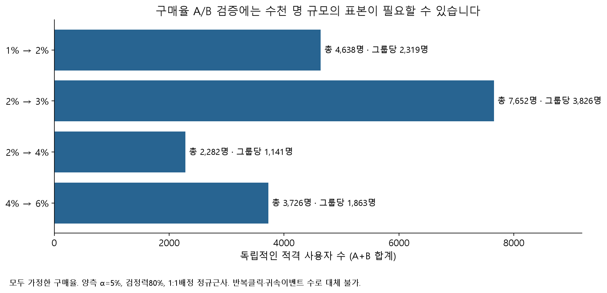

구매율이 가정2%에서3%로 높아지는 차이를 검출하려면, 양측5%·검정력80%·1:1독립사용자배정의 정규근사에서 **그룹당3,826명,합계7,652명**이 필요합니다. 실제 구매율의 기준선이2%라고 확인한 것은 아닙니다. 최근7일 광고클릭3회만 있는 상태에서 '2주면 검증된다'고 정할 수 없고, 클릭이나 반복방문을독립사용자수로바꿔세지않습니다. 이 표본식은 시간블록실험이나 이익의 평균차 검정에 그대로 적용되지 않습니다. [표본·검정력의 공식 문서](https://www.statsmodels.org/stable/generated/statsmodels.stats.proportion.power_proportions_2indep.html)

최소검출효과는 보기좋은 상승률이 아니라 사업가치·실현가능표본·비용을 함께 보고 시작전에 정합니다. 검정기간과 표본을 사전 고정하고, 유리한날만 골라 종료하거나 유의한 지표가나올때까지바꾸지않습니다. 안전/손실한도 중단은 별도입니다. 실험단위와 교란·검정력은 [Microsoft 연구의 실험설계 논의](https://www.microsoft.com/en-us/research/wp-content/uploads/2016/06/ftir-online-evaluation-final-journal.pdf)에 따라 구분했습니다.

### E. 프로모션의 임팩트는 할인 후 이익으로 평가합니다

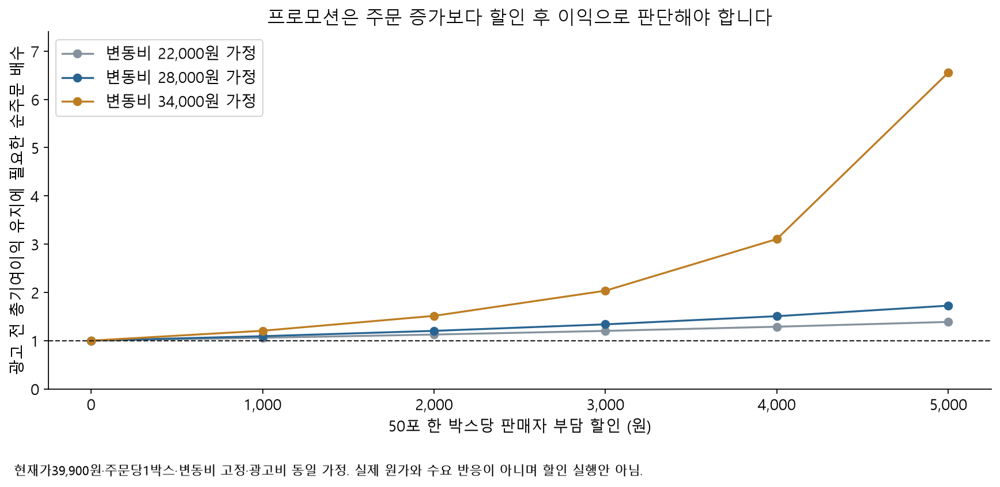

가정상50포가격39,900원·주문당변동비28,000원이면, 판매자부담3,000원할인으로 광고전기여이익이11,900→8,900원입니다. 광고비가같고주문당1박스라면 총기여이익유지에도순주문이약33.7%늘어야합니다. 이 수치는 실제원가나할인반응예측이 아니라 **프로모션이 넘어야 할 손익선**입니다. 할인 후 반복구매가 발생할 수 있어도 현재자료로 장기LTV를넣어적자를정당화하지않습니다.

혜택의 예상효과는 '사용건수×할인액'이 아니라 무작위배정 비교가가능할때의 `사용자당 순기여이익 B−A`와 그 불확실성으로 평가합니다. 전체기간이익차는표본규모 차이를맞춰야하며, 귀속매출증가를전부증분매출로보지않습니다. 묶음/소량제안은팩수와순주문·배송비·기존50포대체를함께비교합니다.

### F. 인사이트를 바로 이어받을 실행 태스크

담당은 현재 확정된 조직 배정이 아니라 **사용자/농원/분석 역할 제안**입니다. 임팩트 수치나 성공확률을 임의로 채우지 않고, 선행조건·준비상태·완료 기준으로 우선순위를 정했습니다.

| ID·우선순위 | 실행 태스크 | 담당 제안 | 상태·선행조건 | 완료 기준·산출물 |
|---|---|---|---|---|
| T00·선행 | 현재로그인과등록매니저의ID/로그인유형·연결스토어를대조하고 판매/유입집계조회 복원 | 사용자+스토어운영자 | 접근제한.등록완료는사실로유지,신규가입/재초대전제아님 | 타깃일별주문/옵션/순팩수·판매/유입자료 조회,분석저장전구매자정보제거 |
| T01·선행 | 출고로트·날짜·보관·재고·일출고능력·구매제한사유를확정하고표시일치 | 농원,분석검수 | 실물출고정보대기 | 실제라벨/표시/배송약속일치.날짜추정연장없음 |
| T02·지금 | 50포·소량·100포의주문당제품/포장/배송/수수료/혜택/반품비를각각계산 | 농원비용제공+분석 | 계산틀준비,실제원가미입력 | 구성별기여이익·허용CPA/CPC·총시험예산/손실한도확정 |
| T03·지금 | 청송사과 포함 첫화면 증빙안2개와 실물사진목록 준비 | 분석+농원촬영 | 사실형초안준비,실물/스토어적용대기 | E1의A/B차이가한가지이며가격·사실·출고조건동일 |
| T04·측정후 | KPI정의대로 주문/팩수/기여이익 집계표와변경/배정기록 구성 | 분석 | T00·T02,플랫폼지원확인 | 같은주집계를다시계산해일치,결측/잠정/미확인분리.배정연결없으면관찰파일럿으로표시 |
| T05·조건부 | E1배정기능·표본충족여부판정,가능하면사전계획뒤시험 | 사용자결정+분석 | T01·T03·T04,기능/표본미확인 | 노출·배정·누락/오염/조건대조와구매·팩수·이익결과.현재는미실행 |
| T06·조건부 | 소량/묶음/혜택 중한가지E2사업제안을선택·검증 | 사용자결정+농원+분석 | T01·T02·T04,예산미확정 | 할인사용자선택편향제거,순팩수·이익대조.지원없으면효과미확정파일럿 |
| T07·출시후 | 성숙한주문코호트의반복구매와100포대체효과점검 | 분석 | 거래자료·충분한관찰기간 | 같은추적기간코호트비교,재구매고객식별이불가하면계산불가표시 |

### G. 팀이 같은 기준으로 결정하는 운영 규칙

- **매일:** 출고가능/측정누락/비용/심사·한도 확인. 매일 유의확률을 확인해 승자를 고르지 않습니다.
- **주1회:** 순팩수·기여이익→순주문/주문당팩수→검색어·매체·모바일구매경로 순서로 점검합니다. 가설·변경·시작조건·손실한도·현재표본·다음결정을한줄로남깁니다.
- **판정:** `보류(자료/기능부족)` / `관찰개선(인과미확정)` / `확대후보(사전효과·이익조건충족)` / `복구·중단(손실/품질/표시오류)`로 구분합니다. 유의하지 않음은 효과0의증거가 아닙니다.
- **지표 해석:** CTR상승만있으면메시지진단진전,순팩수상승·이익하락이면수량성장과손익문제를분리,둘다개선돼도비교배정없으면인과효과는미확정입니다.

E1/E2의 선행조건은 **T00/T01/T02와 T03 준비**입니다. #55 설계 시점에 E1/E2나 자동 A/B는 실행하지 않았으며, 이후 #56에서 기존 광고의 별도 문구 관찰 후보 J-COPY-01을 실제 등록했습니다. 최신 상태는 보고서 상단의 실제 시험 절을 우선합니다. [사전설계의계산근거](juice_experiment_design_2026-10-27.json)와 [재현코드](../scripts/analyze_growth_design.py)를 함께 보존합니다.

---


## 1. 사과즙 수요는 모바일 중심이며, 청송사과 단독과 구매 의도가 다릅니다

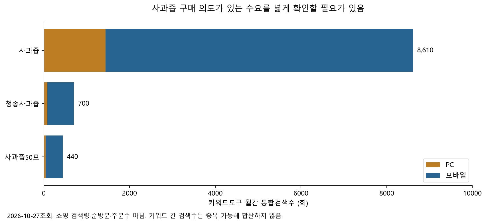

| 키워드 | 월간 PC | 월간 모바일 | 해석·사용처 |
|---|---:|---:|---|
| 청송사과 | 3,140 | 17,000 | 필수 표현 유지. 10/25 쇼핑검색 모바일 광고 진단에서는 카테고리 연관성 부족으로 단독 검색어 노출 불가 |
| 사과즙 | 1,440 | 7,170 | 상품 종류 수요 확인. 광고 자동 매칭의 실제 검색어/구매를 관찰할 대상 |
| 청송사과즙 | 80 | 620 | 산지와 상품 종류를 함께 드러내는 핵심 표현 |
| 사과즙50포 | 40 | 400 | 실제50포 구성과 일치하는 구매형 후보 |
| 청송얼음골사과즙 | <10 | <10 | 현재 검색수 작음. 과거 다른 기간의21클릭과 직접 모순/조작 증거로 보지 않음 |

10/27 계정1755169 키워드도구 조회값입니다. 파워링크 통합검색 범위이며 쇼핑검색에 직접 등록할 입찰 키워드 목록이 아닙니다. `<10`은 정확한0이나10으로 바꾸지 않았습니다. 키워드간 중복 검색 가능성이 있어 합산 시장규모를 만들지 않았습니다. `청송사과즙`의 모바일 비중은88.6%, `사과즙50포`는90.9%라 상품 첫 화면과 구성표는 모바일에서 먼저 읽히도록 준비할 이유가 있습니다.

최근1년 사과즙 검색 추이 화면에서는 2025년11월의 모바일 검색이 높고, 여름에 낮아졌다가 2026년9월 반등하는 모습이 관찰됩니다. 수치가 표시되지 않은 각 점은 임의로 추출·추정하지 않았습니다. 한 해의 통합검색 흐름을 반복적인 시장 계절성이나 판매 예측으로 확정하지 않습니다.

<details><summary>키워드도구의 실제 최근1년 추이 화면</summary>

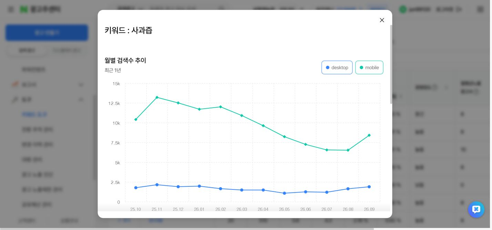

</details>

## 2. 과거 전환은 1–5월에도 있었고, 광고 운영 공백이 길었습니다

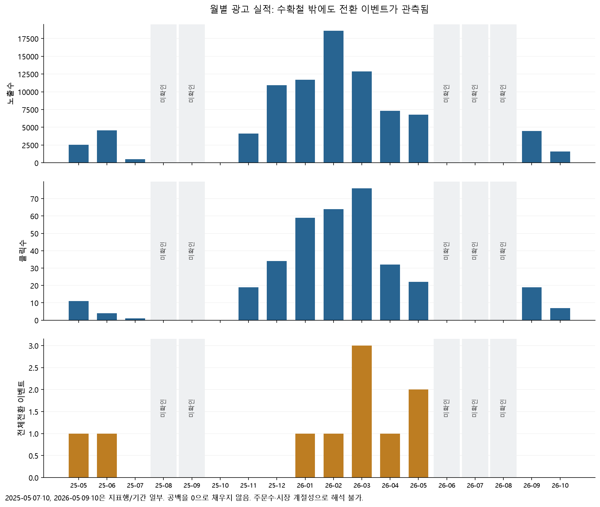

2025년11–12월은15.1k노출·53클릭·3,850원·전체전환0건, 2026년1–5월은57.2k노출·253클릭·20,144원·8건이었습니다. 기간 길이·광고 운영·재고·귀속 조건이 같지 않아 전환율 차이를 계절의 효과로 설명할 수 없습니다. 다만 **수확 직후 판매 준비와 이후 장기 판매 계획을 함께 두어야 할 근거**는 됩니다.

2026년9월–10/19은26클릭·1,570원·전환0건입니다. 이 정도 표본으로 새 시즌 판매 실패를 결론 내리기 어렵습니다. 2025-07-08 이후–10-28 이전111일, 2026-05-27 이후–09-02 이전97일에는 지표 행이 없습니다. 광고OFF·품절·수요소멸 중 무엇인지는 미확인입니다. 공백을0으로 채워 시장 수요가 사라졌다고 설명하지 않았습니다.

전체348클릭은177개의 클릭 발생일에 나뉘었고, 상위20일의 클릭 비중은25.6%입니다. 특정 하루만의 성과에 의존한 자료는 아니지만 전체전환10건은 여전히 작은 표본입니다. 수집한 하루 광고비의 최대는528원으로 현재 일예산10,000원의5.3%입니다. 과거 예산 설정이 현재와 같았는지 모르므로 당시 예산 부족을 배제할 수는 없으나, **일예산 증액이 우선 해법이라는 증거는 없습니다.**

## 3. 검색어 지출은 세 표현에 집중됐지만, 이들이 판매 승자는 아닙니다

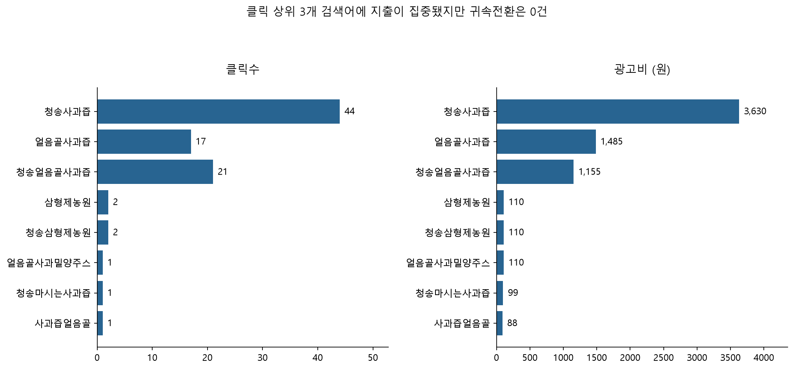

`청송사과즙`44클릭/3,630원, `청송얼음골사과즙`21클릭/1,155원, `얼음골사과즙`17클릭/1,485원입니다. 합쳐82클릭·6,270원으로 클릭이 있었던 검색어104클릭의78.8%, 비용7,678원의81.7%를 차지했지만 세 검색어의 귀속전환은0건입니다. 현재는 유입이 확인된 후보이지 매출을 검증한 우수 키워드가 아닙니다.

`청송얼음골사과즙`의 당시 CTR은21/177=11.86%, `청송사과즙`은44/8,015=0.55%입니다. 검색 의도와 노출 상황이 달라 클릭 반응만 비교한 수치이며, 상품명 변경으로 이런 차이가 생겼다고 확정하지 않습니다. 유일한 전환 검색어 `얼음골사과하나즙`은1클릭1전환이라 승자로 확대할 근거가 부족합니다. 경쟁 브랜드·다른 산지 표현을 상품명에 추가하는 근거로도 사용하지 않습니다.

검색어 CSV는 **클릭이 있는23개 검색어**입니다. 따라서 노출 합계15,283은 전체 검색 노출21,216보다 작습니다. 클릭104와비용7,678원은 전체 검색 매체 합계와 맞지만, 이 파일의 전체CTR을 시장CTR처럼 쓰면 선택 편향이 생깁니다. 전체 소재와 검색어 비용 차이803원·8클릭은 콘텐츠 매체 합계와 일치합니다.

## 4. 모바일 첫 화면과 매체별 측정이 우선입니다

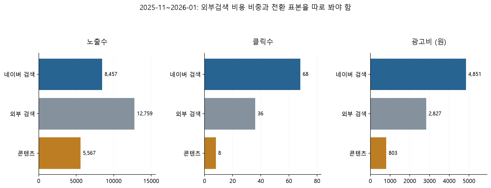

| 매체 | 노출 | 클릭 | 광고비 | CTR | 평균CPC | 전체전환 |
|---|---:|---:|---:|---:|---:|---:|
| 네이버 검색 | 8,457 | 68 | 4,851원 | 0.80% | 71.3원 | 1 |
| 외부 검색 | 12,759 | 36 | 2,827원 | 0.28% | 78.5원 | 0 |
| 콘텐츠 | 5,567 | 8 | 803원 | 0.14% | 100.4원 | 0 |

2025-11-01–2026-01-31의 같은 범위입니다. 외부검색은비용의33.3%, 콘텐츠는9.5%를 사용했습니다. 전환은 네이버검색에서1건이지만 표본1건으로 외부 매체를 일괄 차단할 결론은 아닙니다. 시험 시 매체별 비용과 구매완료·순주문을 따로 보고, 허용 손실에 닿으면 중단 여부를 판단합니다.

같은 기간 모바일은104/112클릭(92.9%), 비용7,964/8,481원(93.9%)입니다. PC는8클릭·517원·전환0건입니다. 모바일 우선 상품 점검의 근거는 되지만 PC를 끄거나 모바일 입찰을 올릴 실험 결과는 아닙니다.

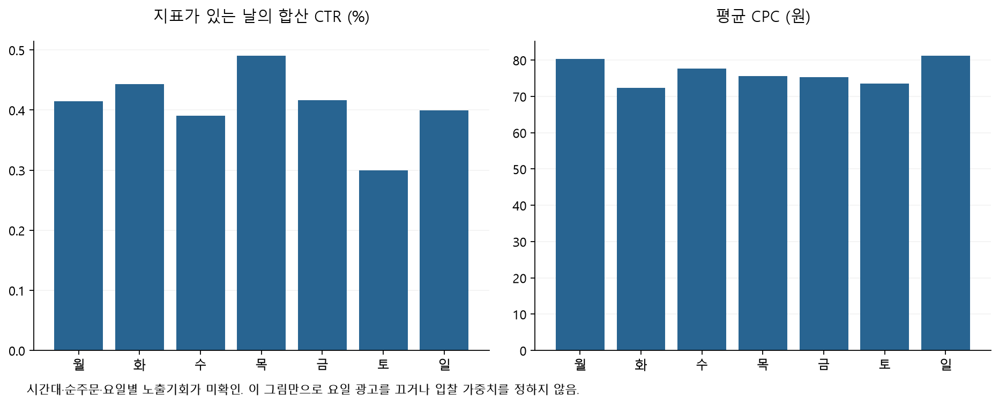

목요일CTR0.49%, 토요일0.30%였고 수요일에전환4건이 몰렸습니다. 순주문·노출기회·재고·시간대·검색어 구성 대조가 없어 '수요일이 잘 팔리는 날'로 운영하지 않습니다. 요일별 지표행은각46개로 계산했고, 하루의 이벤트를 당일 클릭 주문이라고 연결하지 않았습니다.

## 5. 경쟁 8개와 비교하면 가격 외의 설득 근거가 필요합니다

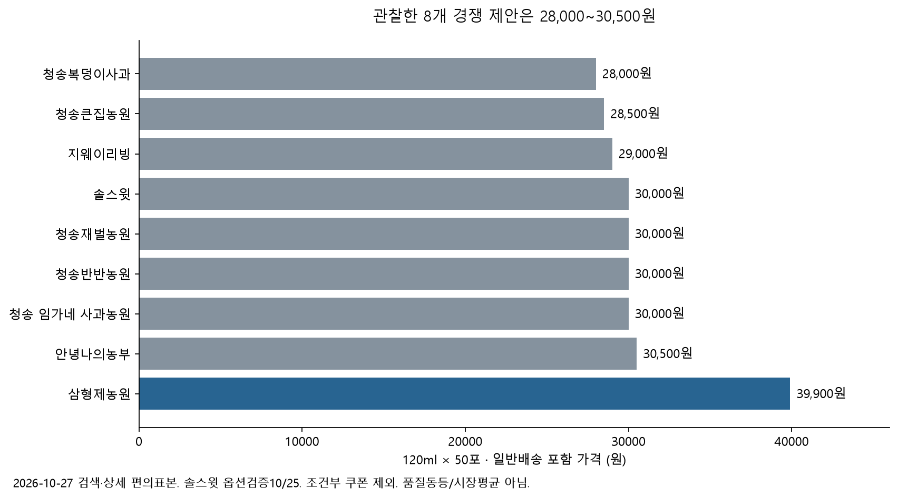

| 판매처 | 120ml50포 가격 | 누적 리뷰 | 확인 범위 |
|---|---:|---:|---|
| [솔스윗](https://smartstore.naver.com/solsweet/products/5086758598) | 30,000원 | 2,388 | 검색 카드; 10/25 50포 옵션 검증 |
| [청송재벌농원](https://smartstore.naver.com/apple4798/products/4856383215) | 30,000원 | 329 | 상세 및 1박스120ml50포 옵션선택 검증 |
| [청송큰집농원](https://smartstore.naver.com/highapple/products/6051514277) | 28,500원 | 231 | 상세120ml50개 및 수량1 총액28500 무료배송 확인 |
| [청송반반농원](https://smartstore.naver.com/banbanfarm/products/13639237830) | 30,000원 | 3 | 상세120ml50포 옵션선택,무료배송; 단위가격 표기오류/생과본문 혼재 |
| [안녕나의농부](https://smartstore.naver.com/sangolpodomaeul/products/3989929742) | 30,500원 | 497 | 상세120ml·50팩 옵션선택·무료배송 |
| [청송복덩이사과](https://smartstore.naver.com/blessing__apple/products/6978056549) | 28,000원 | 46 | 상세120ml·50포1박스 옵션선택·무료배송 |
| [청송 임가네 사과농원](https://smartstore.naver.com/imganeapple/products/4789678248) | 30,000원 | 116 | 상세120ml50포 옵션선택·무료배송 |
| [지웨이리빙](https://smartstore.naver.com/gwayliving/products/13728272279) | 29,000원 | 0 | 상세120ml50개·수량1 총액29000 무료배송 확인 |

네이버가격비교의 해당 검색에 나타난 상품을 확인한 편의표본입니다. 솔스윗은10/25 옵션선택 검증·10/27 카드 확인, 나머지7개는10/27 상세/옵션 확인입니다. 쿠폰 최대할인가·카드혜택·적립은 기본 비교에서 제외했습니다. 품질·제조공정·유통기한의 동등성이나 전체 시장 평균은 미검증입니다. 우리 상품은1리뷰/4.0점이고 비교표에는0–2,388리뷰가 있으므로, 리뷰가 적다는 이유만으로 판매 불가능하다고 단정하지 않습니다.

우리 상품798원/포,665원/100ml에 비해 관찰 경쟁 범위는560–610원/포입니다. 표본의중앙가격30,000원 대비33% 높습니다. 가격 차이를 정당화할 실제 제조공정·원물·라벨·구성과 포장 증빙이 있는지 확인하는 것이 우선입니다. 증빙이 없다면 소량 첫 구매나 묶음 구성을 손익 범위에서 비교할 수 있습니다.

재벌농원·복덩이·임가네의 옵션표에는100포55,000원 제안도 있었습니다. 이는 옵션표 관찰이며 실제100포 결제총액을 끝까지 검증한 가격표가 아닙니다. 같은 고객에게 배송비를 분산시키는 구성 후보로만 참고합니다. 일부 경쟁의 단위가격 오표기·생과 본문 혼재·별점 조건 후기 문구는 모방하지 않습니다.

### 상세페이지는 확인 가능한 차이를 앞에 보여줘야 합니다

1. 첫 화면: **청송사과즙 / 120ml × 50포 / 총6L / 삼형제농원**. 원산지·구성·실결제가격·배송을 짧게 표시합니다.
2. 실물 증빙: 실제 파우치/박스 앞·뒤 라벨,50포 구성,배송 포장 사진. 제조·소비기한·보관조건은 출고 로트에 맞춥니다.
3. 제조 설명: NFC·100%·무첨가·인증은 실제 라벨/문서로 확인한 것만 사용합니다. 경쟁 상품의 설명을 우리 제품 사실로 옮기지 않습니다.
4. 구매 불안: 누액·파손 접수 방법,실제 배송 일정,구매제한 사유를 명확히 안내합니다. 경쟁 리뷰에서 맛·간편함·선물·포장 이슈가 관찰됐지만 대표성 있는 고객 조사나 수치화한 선호율은 아닙니다.

## 6. 가격 할인과 입찰 증액은 손익 조건을 먼저 계산할 수 있습니다

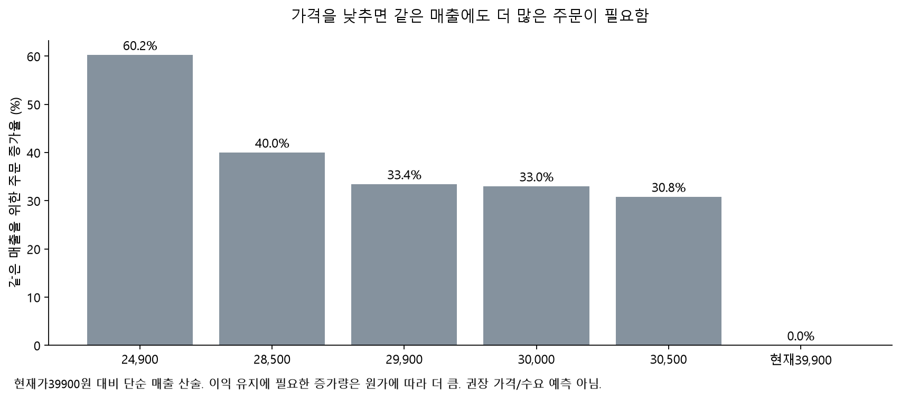

39,900원에서30,000원으로 낮추면 **같은 매출**에도 주문이33% 더 필요합니다. 같은 이익에 필요한 증가는 훨씬 클 수 있습니다. 예를 들어 주문당 변동비를가정28,000원으로 고정하면 광고 전 마진은11,900→2,000원이라 이익 유지에약5.95배 주문이 필요합니다. 실제 원가는 아직 모르므로 이 값은 할인 권고나 예측이 아닙니다. 수수료처럼 가격에 따라 달라지는 비용도 최종 계산에 반영해야 합니다.

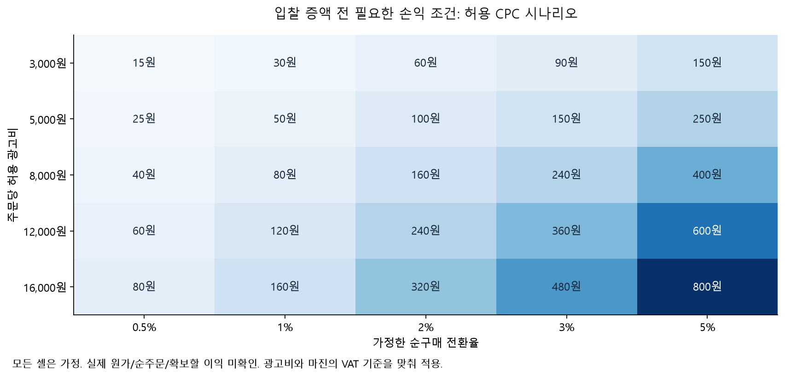

허용CPA=주문당실수취액−생산/포장/배송/수수료/반품손실−확보할이익, 허용CPC=허용CPA×광고 클릭의 보수적 순구매율입니다. 가정상 허용CPA5,000원/구매율1%라면CPC상한50원,8,000원/2%라면160원입니다. 표는 가정 조합이며 실행 예산이 아닙니다. 과거 평균CPC76.6원과 맞추려면 허용CPA8,000원 가정에서약0.96%의 순구매율이 필요합니다. 이 조건을 충족한다고 확인하지 않았습니다.

귀속매출318,300원 대비 광고비26,664원은8.4%입니다. 취소반품·원가·자연매출 대체를 모르므로 귀속ROAS약11.9배를 이익이나 증분매출로 설명하지 않습니다. 총시험예산이 정해지기 전 증액·신규캠페인은 실행하지 않았습니다.

## 7. 적은 클릭으로 전환이 없다는 이유만으로 실패라고 할 수 없습니다

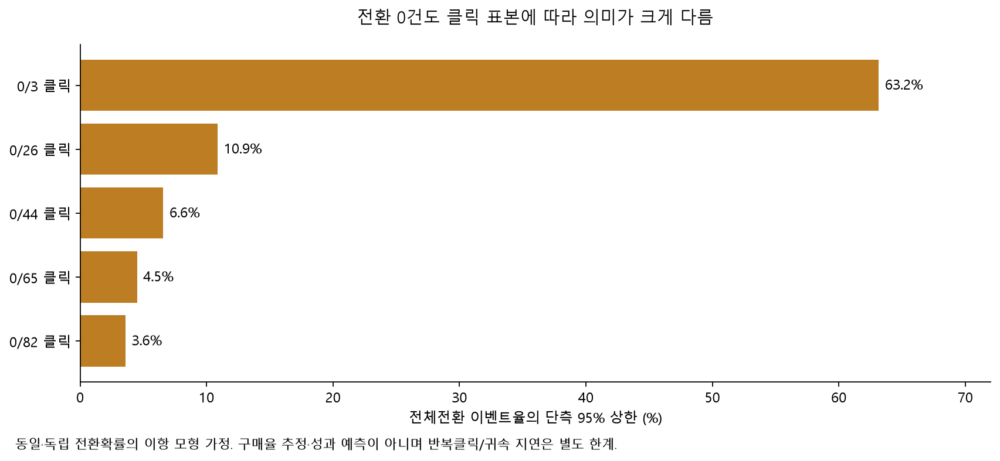

0/3클릭은 동일·독립 전환확률이라는 단순 모형에서도95% 단측 상한약63.2%,0/44는약6.6%입니다. '전환0건'이라는 같은 표현이라도 확보한 클릭 수가 달라 의미가 다릅니다. 이 수치는 전체전환 이벤트의 통계적 민감도 설명이지 실제 구매율의 확정 구간이 아닙니다. 반복클릭·귀속 지연·타입 혼합으로 가정이 어긋날 수 있습니다.

관찰기간과 누적클릭·구매를 함께 보고 한도에 닿으면 판단합니다. '무전환100클릭까지 무조건 집행' 같은 규칙은 만들지 않습니다. 가정CVR1%에서100클릭 중전환0일 확률도약36.6%라 무전환 자체가 실패의 충분조건은 아닙니다.

## 8. 10월27일 #54 분석 조회 당시 상태와 출시 전 수정 우선순위 (후속 시험은 상단 참조)

| 항목 | 확인 결과 | 다음 조치 |
|---|---|---|
| 광고 노출용 제목 | 청송사과즙120ml50포삼형제농원 저장,현재 운영 가능 | 실제 검색어·클릭·구매 관찰. 스토어 기본상품명은 미변경 |
| 추가홍보문구 | **운영 가능·23노출·0클릭·0원** | 심사대기였던10/26 기록을 갱신. 아직 효과 판정 불가 |
| 최근 광고 | 10/20–26:641노출·3클릭·220원·전체/구매완료전환0 | 이전10/19–25와6일 중첩. 서로 빼서 변경효과로 계산하지 않음 |
| 상품 표시 | 제조2025-01-01/유효2026-12-31/소비기한2025-12-31 충돌 유지 | 실제 신규 출고 로트에 맞춰 정정. 기한 연장 추정 금지 |
| 배송·구매제한 | 화면은지금결제시10/28발송예정·오늘출발,최대1개(1인) | 사용자수확후판매계획과 실제 재고/출고가능성 대조. 사실 확인 전 약속 확대 금지 |
| 스토어 관리 | jun99120 간편로그인 후 관리할 스토어 없음 재현 | 등록완료는 사용자 확인 사실 유지. 현재 계정연결 문제로 주문·자연유입 조회 불가 |

#54 분석 시점에는 조회·로컬 분석만 수행했으며, 이후 #56의 실제 시험 등록은 상단에 구분해 기록했습니다. 10/26 상품명·문구를 함께 바꿔 각각의 인과효과를 분리하기 어렵습니다. 실제 광고 노출과 상품 검색의 자연노출은 서로 다른 지표입니다. [네이버 공식 안내](https://help.pay.naver.com/faq/content.help?faqId=10891)는 광고 표기와 상품 연관도·입찰의 반영을 설명합니다.

## 9. 지금 가능한 범위와 더 필요한 자료

| 분석 범위 | 이번 수행 결과 | 남은 한계 |
|---|---|---|
| 원본 품질·중복·합계 | 일별322행/날짜중복0,월집계·시즌매체 합계 일치,직접9+간접1=10 | 삭제광고·다른계정 이력,2024초 자료 미포함 |
| 월/시즌·요일·집중도 | 전기간 월별·요일별,클릭상위일 기여,긴행공백 분석 | 운영이력·재고대조 없이 인과/시장계절성 추정 불가 |
| 검색어·의도·비용 집중 | 클릭23검색어·상위3 지출·범위차이 검산 | 전체 검색어의 0클릭 행 원본이 CSV에 없음 |
| 광고 매체·기기 | 시즌51행,검색/콘텐츠/외부검색·PC/모바일 분석 | 장기 매체추이·현재 전체기간의시간대/성별/나이별실적 미수집 |
| 현재 키워드 수요 | 5시드 및 연관5개 표시,최근1년 사과즙추이 확인 | 통합검색 범위. 쇼핑 클릭 상대지수·시장점유율 미확인 |
| 경쟁 가격·구성·리뷰·표시 | 8개 판매처,무료배송/쿠폰분리·50포 선택/상세 대조 | 품질동등·실제판매량·전체시장 전수 아님 |
| 타깃 상품·광고 현황 | 현가격/구성/기한/배송/제한·제목/홍보문구/실노출 재조회 | 실물 로트·제조방식·당장출고가능재고는 미확인 |
| 할인·묶음·광고 손익 | 가격별 매출 유지조건,허용CPC 민감도,소량/100포 대안 | 원가·수수료·배송비·반품비·승인총예산 미확인 |
| 순주문·팩수·취소반품·재구매 | 필요 정의·조회경로 정리 | 현재 스토어 세션 접근 제한. 데이터 없음으로 표시하지 않음 |
| 자연검색·방문→구매·장바구니 | 측정항목과 해석조건 정리 | 스토어마케팅/판매분석 접근 제한 |
| 상세/사진 개선 실험 | 사실 중심 초안·촬영목록·모바일 우선 준비 | 실물사진·라벨 없음,원재료/효능·인증 추정 금지 |
| 변경 효과·증분이익·매출 예측 | 중첩기간·작은표본·전환정의 한계 확인 | 출시후 충분한 관찰·순주문·비교조건 필요. 지금 예측값 만들지 않음 |

확보한 수치로 가능한 분석은 위 범위까지 수행했습니다. '모든 분석 완료'는 모든 시스템 자료를 확보했다는 의미가 아니며, **접근 제한·아직 발생하지 않은 판매·원가 미확인 때문에 계산할 수 없는 질문**은 남아 있습니다. 지금 가격·시간대 입찰 최적값이나 매출 보장을 숫자로 제시하면 자료보다 강한 결론이 됩니다.

## 10. 11월 판매를 위한 실행 순서

| 시점 | 실행할 일 | 성과 판단 |
|---|---|---|
| 지금–수확/가공 전 | 청송사과즙 중심 문구·모바일 첫화면·실물 촬영목록·가격/구성 후보 준비,실제 원가 입력 틀 마련 | 준비 문구가 실제 제품과 일치하는가 |
| 실제 판매 가능일 확정 직전 | 날짜/보관·재고·출고 약속·1인1개 제한 목적·실물 사진 확정,순주문 측정 가능성 대조 | 잘못된 정보 없이 주문을 받을 수 있는가 |
| 판매 첫주 | 기존 조건에서 검색어/매체별노출·클릭·구매완료·취소반품 후 주문/팩수·이익 기록 | 손실한도 내에서 구매까지 연결되는가 |
| 둘째주 이후 | 가격/구성 또는입찰 중 한 변수씩 비교,광고없는 자연유입도 별도 확인 | 주문이 늘고 광고후 이익도 유지되는가 |

판단 분기: 노출 없음→심사/연동/검색어 적합성,노출있고클릭적음→사진·실결제가격·구성·의도,클릭있고구매적음→상세증빙·배송·제한·가격,주문늘고이익감소→할인·광고·포장배송·반품비를 먼저 점검합니다. 모든 원인을 상품명이나 예산 하나로 설명하지 않습니다.

<details><summary>정확한 월별 수치·출처·산식</summary>

| 월 | 지표행 수 | 노출 | 클릭 | 비용(원) | 전체전환 | CTR |
|---|---:|---:|---:|---:|---:|---:|
| 2025-05 | 24 | 2,532 | 11 | 649 | 1 | 0.43% |
| 2025-06 | 30 | 4,583 | 4 | 396 | 1 | 0.09% |
| 2025-07 | 8 | 526 | 1 | 55 | 0 | 0.19% |
| 2025-10 | 4 | 32 | 0 | 0 | 0 | 0.00% |
| 2025-11 | 30 | 4,138 | 19 | 1,353 | 0 | 0.46% |
| 2025-12 | 31 | 10,932 | 34 | 2,497 | 0 | 0.31% |
| 2026-01 | 31 | 11,713 | 59 | 4,631 | 1 | 0.50% |
| 2026-02 | 28 | 18,584 | 64 | 5,115 | 1 | 0.34% |
| 2026-03 | 31 | 12,873 | 76 | 6,017 | 3 | 0.59% |
| 2026-04 | 30 | 7,304 | 32 | 2,422 | 1 | 0.44% |
| 2026-05 | 27 | 6,771 | 22 | 1,959 | 2 | 0.32% |
| 2026-09 | 29 | 4,464 | 19 | 1,122 | 0 | 0.43% |
| 2026-10 | 19 | 1,573 | 7 | 448 | 0 | 0.45% |

- 광고 일별 원본: [ads_history_expanded](ads_history_expanded_2026-10-20.json),322행·2025-05-08–2026-10-19의관측행. 수집일10/20. 광고계정1755169·상품11659930652.
- [시즌매체51행](ads_media_2025-11-01_2026-01-31.json),[클릭검색어23개](ads_search_term_clicks_2025-11-01_2026-01-31.csv). 검색어노출은클릭있는행만 포함.
- 신규조회: [현재광고](apple_juice_live_2026-10-27.json),[키워드수요](juice_keyword_demand_2026-10-27.json),[경쟁8개](juice_competitors_2026-10-27.json),[타깃표시](juice_own_listing_2026-10-27.json). 조회일10/27.
- 규격·주스·선물 관련5개 시드의 추가조회는 화면이 장시간 대기 상태여서 신규 결과를 검증하지 못했다. 이전 표시값을 추가조회 결과로 재사용하지 않았다.
- [계산결과](juice_extended_metrics_2026-10-27.json),[재현계산](../scripts/analyze_juice_report.py). 금액은원,거래수 아닌전체전환이벤트. 비율은합산분자/분모로계산,월별비율단순평균안함.
- 전환0건단측95%상한=1−0.05^(1/n). 동일·독립이항가정. 실제순구매율/귀속이벤트독립성미검증.
- 가격인하매출유지주문증가율=39900/새가격−1. 이익유지수량배수=(기존가격−고정가정변동비)/(새가격−고정가정변동비). 분모0이하면확대조건을계산하지않음.
- 보고서의숫자시나리오는승인예산·실제원가·판매예측과구분. 실물·순주문·재고·광고기여기간대조미완료.
- 원본은개인정보를저장하지않은상품/날짜/검색어집계이며,전화번호형검색어는제거표시. 키값·구매자이름/주소/연락처미포함.

</details>

<details><summary>이전 분석·실제 변경 이력 원문 (10월20–26일)</summary>

<!-- LEGACY_ANALYSIS_BEGIN -->
# 사과즙(11659930652) 판매량 증가 분석·실행안 — Claude Code, 2026-10-20

> **최신 보완: 2026-10-25 #48.** 이 문서 마지막 절에 실제 상품규격·소비기한 표시 충돌·구매수량 제한·경쟁 옵션·광고 미노출 진단을 추가했다. 아래10/20의 '상품 상세 미확인'은 당시 상태이며, '노출 부족이 가장 큰 병목/전환이 괜찮음'은 검증 전 가설이다. 최신 판단은 마지막 절을 우선한다.

타깃: https://smartstore.naver.com/threebrothersfarmm/products/11659930652 (광고상품 ID 89204441119, 광고계정 1755169)
필수 표현: 정확한 문자열 **청송사과**. 자동 매칭 광고에서 해당 검색어 노출이 보장된다는 뜻은 아니다.
이전 `fresh_apple_history_analysis.md`의 생과 실행안은 과거 기록이다. 이 문서는 사과즙에만 적용한다.

## 0. 이번 세션의 조사 한계 (먼저 읽을 것)

- Claude Code의 Chrome 확장·내장 브라우저·WebFetch가 `smartstore.naver.com`, `sell.smartstore.naver.com`, `ads.naver.com`을 모두 "safety restrictions / unable to fetch"로 거부했다. 따라서 **이 문서에서는 상품 상세, 옵션, 리뷰, 경쟁 상품을 새로 확인하지 못했다.**
- 아래 광고 수치는 Codex가 `result/`에 저장한 파일을 재계산한 것이다. 네이버 화면을 이번에 다시 조회하지 않았다.
- 상품 용량(ml)·포수·원재료·제조방식은 어떤 저장 파일에도 없다. 값을 만들지 않고 "미확인"으로 둔다.
- 공식 기준(SEO PDF, FAQ 4814/15578/15662/1196/245)은 Codex가 2026-10-20에 대조한 `fresh_apple_history_analysis.md` §5를 그대로 따른다. 오늘 다시 확인하지 않았다.

## 1. 확인된 사실

### 1-1. 광고 실적 (출처: `ads_history_expanded_2026-10-20.json`, 322행)

| 항목 | 값 | 계산 |
|---|---:|---|
| 노출 | 86,025 | |
| 클릭 | 348 | CTR 0.40% (95% 구간 0.36–0.45%) |
| 광고비 | 26,664원 | 평균 CPC 약 77원 |
| 전체전환 | 10 | 클릭→전환 2.87% (95% 구간 1.6–5.2%) |
| 귀속매출 | 318,300원 | 전환당 약 31,830원, 광고비 대비 약 11.9배 |
| 전환당 광고비 | 약 2,666원 | 광고비 ÷ 전체전환 |

주의: 전체전환은 광고 귀속 이벤트(15일 귀속)이며 취소·반품을 뺀 순주문이 아니다. 판매량(팩·박스 수)도 아니다. 10건이라 구간이 넓다. 전환 매출이 24,900–40,000원대로 흩어져 있어(예: 2025-05·06 각 24,900원, 2026-01 28,900원, 2026-02 29,900원) 판매 옵션이나 가격이 시기별로 달랐을 가능성이 있다. 현재 표시가 39,900원은 과거 결제가가 아니다.

### 1-2. 월별 (같은 파일 `monthly`)

| 월 | 노출 | 클릭 | 광고비 | 전환 | 귀속매출 | CTR |
|---|---:|---:|---:|---:|---:|---:|
| 2025-05 | 2,532 | 11 | 649 | 1 | 24,900 | 0.43% |
| 2025-06 | 4,583 | 4 | 396 | 1 | 24,900 | 0.09% |
| 2025-07 | 526 | 1 | 55 | 0 | 0 | 0.19% |
| 2025-11 | 4,138 | 19 | 1,353 | 0 | 0 | 0.46% |
| 2025-12 | 10,932 | 34 | 2,497 | 0 | 0 | 0.31% |
| 2026-01 | 11,713 | 59 | 4,631 | 1 | 28,900 | 0.50% |
| 2026-02 | 18,584 | 64 | 5,115 | 1 | 29,900 | 0.34% |
| 2026-03 | 12,873 | 76 | 6,017 | 3 | 99,800 | 0.59% |
| 2026-04 | 7,304 | 32 | 2,422 | 1 | 40,000 | 0.44% |
| 2026-05 | 6,771 | 22 | 1,959 | 2 | 69,900 | 0.32% |
| 2026-09 | 4,464 | 19 | 1,122 | 0 | 0 | 0.43% |
| 2026-10 | 1,573 | 7 | 448 | 0 | 0 | 0.45% |

(2025-10은 32노출, 2025-08·09와 2026-06·07·08은 집계에 행이 없다.)

관찰: 전환은 11–12월(생과 시즌)이 아니라 1–5월에 나왔다. 사과즙은 출하 시즌과 다른 수요 패턴일 수 있다. 월 전환이 0–3건이라 시즌성을 단정하지 않는다. 최근 2개월(9–10월)은 26클릭에 전환 0이다. 이 정도 표본으로 악화라고 판단하지 않는다.

### 1-3. 검색어 (2025-11–2026-01, `ads_search_term_clicks_*.csv`, 클릭이 있던 23개)

| 검색어 | 노출 | 클릭 | CTR | 광고비 | 전환 |
|---|---:|---:|---:|---:|---:|
| 청송사과즙 | 8,015 | 44 | 0.55% | 3,630원 | 0 |
| 얼음골사과즙 | 2,674 | 17 | 0.64% | 1,485원 | 0 |
| 청송얼음골사과즙 | 177 | 21 | 11.9% | 1,155원 | 0 |
| 형제농원 | 3,896 | 1 | 0.03% | 55원 | 0 |
| 삼형제농원 | 235 | 2 | 0.85% | 110원 | 0 |
| 얼음골사과하나즙 | 1 | 1 | 100% | 88원 | 1 (28,900원) |

- 이 23개의 광고비 합계는 7,678원이다. 같은 기간 전체 8,481원과의 차이(803원)는 콘텐츠 매체 클릭으로 Codex가 이미 대조했다.
- 전환이 붙은 검색어는 노출 1회짜리 검색어 하나다. 그 검색어를 성공 키워드로 보지 않는다.
- `청송사과`라는 문자열 자체는 이 23개 중에 없다. `청송사과즙`이 가장 큰 수요 검색어다. (이 보고서의 모든 검색어는 클릭이 있었던 것만 포함하므로, 클릭 없이 노출만 된 검색어는 알 수 없다.)
- `청송얼음골사과즙`은 노출은 적지만 CTR이 매우 높다. 상품명에 "청송 얼음골 사과즙"이 이미 있어 적합도가 높은 것으로 보이나, 전환은 아직 없다. 인과는 모른다.
- `형제농원`은 3,896노출에 클릭 1회다. 이름 일부가 겹치는 다른 업체 검색일 수 있다(미확인).

### 1-4. 매체 (2025-11–2026-01, `ads_media_*.json`, Codex 대조 완료)

| 구분 | 노출 | 클릭 | 광고비 | 전환 |
|---|---:|---:|---:|---:|
| 네이버 검색 | 8,457 | 68 | 4,851원 | 1 |
| 네이버 콘텐츠 | 5,567 | 8 | 803원 | 0 |
| 외부 검색 | 12,759 | 36 | 2,827원 | 0 |

전환은 네이버 통합검색 모바일(4,236노출/41클릭/2,915원)에서 1건이다. 외부 검색이 비용의 약 33%를 썼다. 표본이 작아 외부 매체를 끄라고 단정하지 않는다.

### 1-5. 계정 설정 (출처: `farm_ads_ui_evidence.json`, 2026-10-19 화면)

- 캠페인 `쇼핑검색#1` ON, 일예산 10,000원, 그룹 입찰가 100원(VAT 제외), 매체 "모든 매체", 제외검색어 0, 확장소재 0, 전환추적 사용중(15일 귀속), 잔액 23,431원.
- 현재 소재는 사과즙 1개(39,900원, 무료배송).
- 하루 평균 지출이 수십–수백 원이므로 일예산 10,000원은 한도 역할을 하지 못한다. 노출이 적은 이유는 예산이 아니라 입찰·매칭·경쟁일 가능성이 있다(원인 미확인).

### 1-6. 공개 상품 정보 (출처: `farm_ads_ui_evidence.json`, 이전 보고서)

- 현재 상품명: "청송 얼음골 사과주스 사과즙 생과 착즙 무첨가 삼형제농원". 가격 39,900원, 무료배송, 리뷰 1개/평점 4.0.
- 상품명에 "청송 얼음골"은 있으나 정확한 문자열 "청송사과"는 없다.
- "사과주스"와 "사과즙"이 함께 들어 있다. "무첨가·착즙·생과"는 확인된 증거가 문서에 없다. 증거 없이 유지하면 안 된다.

## 2. 병목 진단 (노출→클릭→구매)

1. **노출 규모가 작다.** 13개월 동안 86,025회, 월 평균 약 6,600회. 월 클릭 수십 건으로는 월 전환이 0–3건을 오가는 것이 정상 범위다. 가장 큰 병목은 노출 볼륨으로 보인다.
2. **CTR은 낮다.** 0.40%. 클릭이 높았던 검색어(청송얼음골사과즙 11.9%)는 상품명과 거의 같은 검색어다. 일반 검색어에서는 상품명·대표사진·가격이 눈에 띄는지 의문이다(경쟁 대비 비교는 이번에 못 했다).
3. **클릭 이후 전환은 나쁘지 않아 보인다.** 2.87%(구간 1.6–5.2%). 광고비 대비 귀속매출이 높게 나왔지만, 원가·취소·반품 전의 수치다.
4. **사회적 증거가 약하다.** 리뷰 1개. 네이버 쇼핑 공식 기준이 인기도·신뢰도(최근 판매·리뷰·서비스 품질)를 본다고 안내하므로(§5 인용), 리뷰 부족은 노출 순위에서 불리할 가능성이 있다. 리뷰를 인위적으로 늘리는 방법은 쓰지 않는다.

## 3. 우선 실행 3가지

1. **상품 사실 확정 후 상품명·첫 화면 정리(접속 후 즉시).** 용량(ml)×포수, 원재료·함량, 착즙 방식, 제조원, 보관, 소비기한, 재고를 친구에게 확인한다. 확인된 것만 상품명에 쓴다. 아래 상품명 후보 참고.
2. **원가 기반 CPA·CPC 상한 계산 후 입찰 시험.** 현재 입찰 100원/평균 CPC 77원에서 노출이 적다. 원가를 알아야 입찰을 올릴 수 있다. §6 계산식을 쓴다. 총 시험 손실 한도를 친구와 먼저 정한다.
3. **구매 후 리뷰 확보 장치.** 정상 구매자에게 리뷰 작성을 안내하는 일상 운영(동봉 안내문 등). 대가를 약속하는 방식은 쓰지 않는다. 광고는 리뷰가 늘 때까지 소액으로 유지한다.

## 4. 상품명 후보 (모두 "청송사과" 포함, 괄호는 확정 후 채움)

실제 확인되기 전에는 적용하지 않는다. 제목에 "청송사과"를 넣어도 그 검색어 광고 노출이 보장되는 것은 아니다.

1. `청송사과 얼음골 사과즙 {용량}ml {포수}포 삼형제농원`
2. `청송사과즙 {용량}ml×{포수}포 삼형제농원` ("청송사과즙"은 "청송사과"를 문자열로 포함하며 실제 최다 수요 검색어와 일치)
3. `청송사과 착즙 사과주스 {포수}포 삼형제농원` ("착즙"은 방식 확인 시에만)

공통: "사과즙"과 "사과주스"를 둘 다 넣을 필요는 없다(중복). 증거 없는 "무첨가·100%·NFC·당도"는 넣지 않는다. 첫 화면: 용량×포수, 원재료 함량, 제조·착즙 방식(확인된 것), 소비기한, 보관법, 출고 안내, 실제 제품 박스·팩 사진.

## 5. 공식 기준 요약 (Codex 확인 사항 인용, 재확인 안 함)

- 쇼핑몰 상품형 광고는 상품정보로 검색어를 자동 매칭한다. 아래 검색어는 직접 입찰 키워드 목록이 아니라 상품 정비·검색어 점검용이다.
- 상품명은 핵심 정보를 간결하게. 관련 없는 인기어 반복 금지. 속성·카테고리 정확성 필요.
- 가격비교와 플러스스토어는 기준(개인 선호도·굿서비스 등)이 다르므로 측정을 나눈다.

## 6. 이익 기반 목표 계산 (원가를 모르므로 계산식만)

```
주문당 광고 전 기여이익 = 실제 수취 매출 − 제품 원가 − 포장 − 배송 − 수수료 − 판매자 부담 혜택 − 기대 반품·보상비
목표 CPA            = 광고 전 기여이익 − 남기려는 주문당 이익
허용 실제 CPC       = 목표 CPA × 클릭→구매 전환율
```

필요한 입력(미확인): 원가, 포장비, 배송비 부담, 수수료율, 쿠폰·혜택, 반품률.

참고 예시(가상, 실제 원가 아님): 기여이익 10,000원, 남기려는 이익 5,000원이면 CPA 상한 5,000원. 전환율이 1%/2%/3%이면 허용 CPC는 50/100/150원. 관측 전환율 2.87%(구간 1.6–5.2%)와 평균 CPC 77원을 비교하면, 기여이익이 클수록 입찰을 올릴 여지가 생긴다. 입찰 증액은 실제 기여이익이 확인된 뒤에만 한다. 관측 전환율은 귀속 전환 기준이고 표본이 작다.

## 7. 광고 운영 가설 (시험으로만 취급)

| 가설 | 근거 | 확인 방법 | 중단 조건 |
|---|---|---|---|
| 입찰이 낮아 노출이 적다 | 입찰 100원, 노출 월 수천 | 소폭 증액 후 노출·CTR·CPC 비교 | 합의한 손실 한도 도달, CPC가 허용 CPC 초과 |
| 상품명 개선으로 CTR이 오른다 | CTR 0.40%, 상품명에 "청송사과" 없음 | 상품명 변경일 기록, 전후 CTR (다른 변화 동시 기록) | 전후 비교만으로 인과 단정 금지 |
| 네이버 검색 모바일이 효율적 | 전환 1건 모두 여기 | 매체별 비용·전환 계속 분리 기록 | 표본 부족 시 유지 |
| 외부 검색 비중이 비효율적 | 비용 33%, 전환 0 | 매체 제외 후보로만 검토 | 전환 확인되면 유지 |

유지/확대 검토 검색어: 청송사과즙, 청송얼음골사과즙, 얼음골사과즙(상품명과 직접 일치하는 의도). 제외 검토: 형제농원처럼 의도가 불명확하고 클릭이 거의 없는 검색어. 단, "즙/주스/착즙" 계열은 이 상품의 핵심 의도이므로 제외하지 않는다. 쇼핑몰 상품형 자동 매칭에서는 검색어 입찰을 직접 설정하지 못하므로 제외검색어 기능의 적용 범위는 계정 화면에서 확인해야 한다.

## 8. 첫 2주 계획 (접근 가능한 사람이 수행)

| 기간 | 작업 | 통과 기준 |
|---|---|---|
| 1–3일 | 상품 사실·원가·재고 확인, 경쟁 비교표 작성(§9 템플릿) | 용량×포수·원재료·가격이 확정되고 주문당 기여이익 계산 가능 |
| 4–5일 | 상품명·상세 첫 화면·실제 사진 수정안 확정 | 증거 없는 문구 없음, "청송사과" 포함 |
| 6–7일 | 변경 적용(친구/사용자 승인 후), 변경일·가격·재고 동시 변화 기록 | |
| 8–14일 | 소액 입찰 시험, 매일 비용·검색어·매체·주문 기록 | 손실 한도 준수. 클릭 증가가 아닌 순주문·팩 수량·이익으로 평가 |

측정: 광고 귀속 전환과 스토어 실제 주문(취소·반품 제외, 박스·팩 수량 포함)을 따로 보고한다. 노출·클릭 증가만으로 성공이라고 평가하지 않는다. 광고 귀속 15일 지연을 고려해 초기 수치는 잠정으로 표시한다.

## 9. 아직 못 한 것 (다음 세션/Codex/사용자)

1. 타깃 상품 상세 확인: 용량·포수·옵션·가격·배송비·원재료·제조·보관·소비기한·리뷰 내용. 접근 가능한 도구에서 `result/apple_juice_competitor_template.csv` 형식으로 기록.
2. 경쟁 상품 5–10개 비교: 검색어 `청송사과즙`, `청송사과 주스`, 확인된 특성에 맞는 검색어. 광고/자연검색을 구분하고 조회일·영역·조건 기록. 팩당·100ml당·총용량당 가격 계산. 광고 링크를 클릭해 비용을 발생시키지 않는다. 동명 농원을 친구 스토어로 오인하지 않는다.
3. 주문·취소·반품·자연유입 대조(스마트스토어센터 접속 문제 미해결).
4. 제외검색어·확장소재 기능의 실제 적용 범위 확인(광고 화면).

변경·광고 활성화·충전·예산·권한·약관·초대 수락은 하지 않았다. 커밋하지 않았다. `.env` 값은 출력하지 않았다.

## 10. 추가 분석 — 2026-10-25, #48 (현재 우선 실행안)

### 10-1. 실제 광고 노출 진단: 입찰부터 올리면 안 되는 이유

Chrome에서 jun99120·삼형제농원1755169·운영 관리 정상접속. **검색광고 → 도구 → 광고 노출 진단 → 쇼핑검색(노출현황진단)**을 실제 조회했다. 소재ID `nad-a001-02-000000378841949`, 연령/성별은 기본 '알 수 없음'. 상품 설정 변경 없이 조회만 했다.

| 검색어 | 조회 영역 | 실제 표시 결과 |
|---|---|---|
| 청송사과즙 | 통합검색 모바일 및 쇼핑검색 모바일 | 광고 노출 가능한 요건 충족. 실제 노출 보장 아님 |
| 청송얼음골사과즙 | 쇼핑검색 모바일 | 광고 노출 가능한 요건 충족. 실제 노출 보장 아님 |
| 청송사과 | 쇼핑검색 모바일 | **카테고리 연관성 부족으로 광고 노출 불가** |

정확한 예상 순위 숫자는 화면에 반환되지 않았다. 위 조건·조회시점의 진단이지 모든 기기·성별·연령·시각의 고정 결과는 아니다. '청송사과'의 실제 표시 사유는 **광고노출 가능 카테고리 아님 / 키워드와 상품 카테고리의 연관성이 부족해 광고가 노출되지 않습니다**였다.

**실행 함의**: '청송사과' 단독 검색에 입찰만 올리는 해결책은 현재 진단과 맞지 않는다. 사과즙의 올바른 카테고리를 생과 사과로 바꾸지 않는다. 필수 문자열 `청송사과`는 제목·문구에 유지하면서 `청송사과즙`, `청송얼음골사과즙`처럼 사과즙 구매 의도에 맞는 검색 유입을 우선한다. `청송사과즙`에는 `청송사과`가 포함된다. 이것이 단독 '청송사과' 광고 매칭 보장이라는 뜻은 아니다. 단독 검색 노출이 별도 필수 목표라면 그 제약과 다른 광고 유형의 적합성을 따로 검토해야 한다.

공식 기능 근거: [노출 진단 FAQ1226](https://ads.naver.com/help/faq/1226). 상품정보 기반 자동매칭과 중복 소재 주의: [FAQ245](https://ads.naver.com/help/faq/245). 같은 상품을 검색어별 그룹에 복제해 노출을 늘리려는 안은 사용하지 않는다.

### 10-2. 상품 페이지에서 새로 확인한 구매 병목 후보

출처: [타깃 공개 상품](https://smartstore.naver.com/threebrothersfarmm/products/11659930652),2026-10-25 Chrome 실제 조회. 현재 구매하기 버튼 있음. 판매자 입력값과 실제 출고 제품이 같은지는 별도 확인 필요.

| 항목 | 확인값 | 조치의 목적 |
|---|---|---|
| 구성 | **120ml×50포**, 총6,000ml | 제목·대표사진·상세 첫 화면에서 구매 구성을 즉시 알리기 |
| 가격 | 39,900원, 일반 무료배송 | 1포798원·100ml665원으로 동일 구성과 비교 |
| 추가배송 | 제주/도서 추가4,000원 표시 | 일반 무료배송과 조건 구분 |
| 날짜 표시 | 제조2025-01-01 / 유효2026-12-31 / 소비기한 또는 품질유지기한2025-12-31 | **서로 다른 날짜를 실제 출고 로트·표시사항과 대조해 정리** |
| 구매 제한 | **최대구매1개(1인)** | 여러 박스 수요를 제한할 수 있으므로 설정 의도 확인 |
| 후기 | 1개·4.0 | 구매 근거 보강 후보. 조작/별점 조건부 유도 금지 |

소비기한 표시 충돌은 오래된 등록정보일 수 있다. 실제 출고 제품이 기한을 넘겼다고 확정한 것이 아니다. 다만 구매자가 판단하는 화면에서 날짜가 충돌하므로 **광고 증액 전에 확인·수정할 우선 항목**이다. 수량 제한 역시 재고나 행사 목적일 수 있어 무조건 해제하지 않는다. 1인 제한이 누적 제한인지 주문별인지 등 운영 의미는 관리자 설정에서 확인한다.

원재료 함량·실제 착즙/살균 방식·보관방법·NFC/무첨가 증빙은 아직 확보하지 못했다. 현재 제목에 있다는 이유로 입증된 제품 특성으로 쓰지 않는다. 대표사진/후기영상이 실제 구매 구성과 품질을 충분히 보여주는지 모바일로 점검하는 것은 후속 작업이다.

**바로 검토 가능한 상품명**: `청송사과즙 120ml 50포 삼형제농원`.
청송 얼음골 출처도 실제 증빙과 일치한다면 `청송사과즙 얼음골 120ml 50포 삼형제농원`을 비교안으로 검토한다. 기존 제목에 빠진 용량·포수를 넣고 생과로 혼동할 수 있는 나열을 줄인다. 순위 상승이나 클릭 증가를 보장하지 않는다.

### 10-3. 가격 비교: 같은 포수에서 약33% 차이

네이버 가격비교 `청송사과즙120ml50포`, PC 로그인·네이버 랭킹순, 보이는 카드만 조사했다. 유사 상품 포함 안내가 있었으며 순위나 시장 전체를 대표하지 않는다. 광고 링크는 클릭하지 않고 공개 스토어를 통해 실제 상품을 확인했다.

**옵션까지 검증한 비교 대상**: [솔스윗 사과물래](https://smartstore.naver.com/solsweet/products/5086758598). 50포 옵션을 실제 선택했을 때 **120ml×50포·총액30,000원·무료배송**. 29,000원은 별도 쿠폰 조건이 있는 최대할인가라 기본 비교에서 제외했다. 100포는 옵션에 +27,000원으로 표시됐다. 원재료/제조/품질이 친구 제품과 동일하다고 확인한 것은 아니다.

| 상품 | 50포 표시/선택금액 | 1포 | 100ml |
|---|---:|---:|---:|
| 친구 삼형제농원 | 39,900원 | 798원 | 665원 |
| 솔스윗50포 선택 | 30,000원 | 600원 | 500원 |

동일한 용량·포수의 기본 표시금액은 친구 상품이9,900원·33% 높다. 이 차이가 판매 부진 원인이라는 인과 증거는 없지만, **고객에게 더 지불할 이유가 보이는지** 확인할 근거다. 인증·원재료·맛·제조 과정의 차이가 입증되면 첫 화면에서 설명한다. 입증할 차이가 없다면 원가 안에서 첫 구매 혜택 또는 소량 구성을 시험한다. 즉시30,000원으로 할인하라는 뜻은 아니다.

기타 잠정 관찰: 시골냉장고120ml50포 광고카드27,900원은 선택 옵션 미검증. 청송마루농원은29,900원·120ml50포 공개 상세를 방문했으나 본문에2박스 문구도 있어 확정 동등 비교에서 제외. 이 작은 표본을 시장 최저가·시장 평균으로 부르지 않는다. 경쟁의 식품 효능 문구·조건부 별점 이벤트를 모방하지 않는다.

### 10-4. 기존 실적에서 추가로 얻은 결론

`apple_juice_deeper_metrics_2026-10-25.json`에서322행을 재계산했다.

- 최대 일별 비용은528원이다. 10/19에 확인한 하루 한도10,000원과 비교하면, **단순 일예산 증액이 현재 우선 해법이라는 근거는 없다**. 과거 내내 같은 한도였다고 확인한 것은 아니므로 예산 제약이 전혀 없었다고 단정하지 않는다.
- 실적 행 공백은2025-07-09–10-27 **111일**,2026-05-28–09-01 **97일**이다. 중단·품절·잔액·연동·수요 중 어느 원인인지는 변경이력 대조 전 미확인. 자료 없는 날을 곧바로 광고 OFF라고 부르지 않는다. 전체 달력 평균을 '계속 집행했는데 성과가 낮음'으로 해석하지 않는다.
- 2026년1–5월은253클릭/20,144원/전체전환8/귀속매출268,500원, 최근9–10월은26클릭/1,570원/전환0이다. 기간·수요·가격·운영 조건이 달라 승패나 시즌성을 확정할 수 없다. 구매가 확인되지 않은10개 이벤트를 구매CVR2.87%·주문당CPA2,666원의 확정치로 쓰지 않는다.
- 전체전환10은 직접9·간접1로 나뉜다. 직접/간접 귀속도 구매완료/순주문 검증을 대신하지 못한다. 과거 성공 가격24,900–40,000원이 현재와 다른 구성이었는지 주문/변경이력에서 확인할 가치가 있다.
- 현재 계정 대시보드2026-10-18–24는683노출/3클릭/전체전환0. 계정 합계이고 타깃 구매완료와 대조하지 않았다. 3클릭으로 개선·악화를 판정하지 않는다.

따라서 기존 보고서의 '가장 큰 병목은 노출'·'클릭 이후 전환이 나쁘지 않음'·'CTR이 낮음'은 비교와 구매정의 검증 전 가설로 낮춘다. 지금은 **단독 키워드의 카테고리 제한, 구매 정보의 신뢰 문제, 가격 제안**을 직접 확인했으므로 이 순서가 더 구체적이다.

### 10-5. 노출·클릭·판매를 연결하는 시험안

| 우선 | 조치 초안 | 기대 경로 | 평가·다음 판단 |
|---|---|---|---|
| 1 | 실제 출고 소비기한·표시정보 일치,1인1개 제한 목적 확인, 제품 라벨/구성 사진 보강 | 불안·구매 제약 감소 | 순주문·박스수·팩수, 문의/취소·반품. 실제 상태 확인 전 단순 날짜 연장 금지 |
| 2 | 청송사과즙120ml50포 중심 상품명·속성·사진·첫 화면 정리 | 사과즙 의도와 매칭·클릭 개선 | 같은 검색어/매체의 노출·CTR·구매완료를 비교. 묶음 기본정보 정비는 효과 분리 불가 명시 |
| 3 | 추가홍보문구와 상품부가정보의 현재 등록 상태 점검 후 초안 적용 검토 | 구성·혜택·후기를 광고에서 더 잘 설명 | 클릭과 순주문으로 평가. 확장소재가 순위나 노출량을 직접 보장하지 않음 |
| 4 | 원가가 허용하면 첫 구매 소량/혜택 또는100포 묶음 검토 | 첫 결제 부담 감소·주문당 판매수량 증가 | 50포와 각각 총ml·팩수·주문당이익으로 비교. 배송/포장비와재고 고려, 불필요한 상품 복제 금지 |
| 5 | 요건 충족 검색어에서만 제한된 입찰 시험 | 광고 경매에서 더 많은 노출 기회 확인 | 현재 입찰/가중치 재확인, 원가 기반 CPC상한·손실한도 먼저 결정. 비용만 증가하면 복구 검토 |

확장소재 초안: 문구1 **`청송사과즙50포`**(8자), 문구2 **`청송사과즙 120ml 50포, 삼형제농원`**(22자). 내용은 현재 표시 구성 기준으로 실제 출고와 대조 후 사용한다. [공식FAQ1233](https://ads.naver.com/help/faq/1233)은 문구1최대10자·문구2최대30자 및 서로 다른 지면 노출을 안내한다. 두 문구가 항상 동시에 노출된다고 설명하지 않는다. 10/19 그룹 확장소재0기록은 있지만 현재 캠페인/소재 단위 전체 미등록은 확정하지 않았다.

최초 시험은 한 번에 예산·입찰·가격을 모두 바꾸지 않는다. 기본정보 오류는 함께 정리하되 날짜를 기록한다. 이후 동일한 상품·가격·대표사진·매체 조건에서 입찰만 단계적으로 비교한다. 과거100원 입찰을 기준으로120/150원 후보를 만들 수는 있으나 **현재 입찰·손익·한도 확인 전 설정하지 않는다**. 일예산한도와 소재입찰가를 구분한다. 실제CPC에는 VAT 등 청구 정의를 맞추고, 목표CPA×보수적인 구매CVR 안에 들어야 한다. 10개 전체전환 비율을 확정 구매CVR로 넣지 않는다.

관찰은 날짜뿐 아니라 누적 클릭·주문 수를 함께 본다. 예시로100클릭×실제CPC100원=광고비10,000원은 단순 비용 시나리오이지 승인된 예산이나 판매예측이 아니다. 100클릭도 작은 표본이라 승패를 보장하지 못한다. 한도를 지키면서 실제 구매/순주문과 비용을 확보한 뒤 확대 여부를 정한다.

### 10-6. 10/23 공식 공지의 새 정보

[네이버 공지34974](https://ads.naver.com/notice/34974)를 Chrome으로 직접 읽었다. **11/25(예정)**에 쇼핑몰 상품형·카탈로그형의 기존 품질지수 제공이 종료되고 클릭기대지수10점이 도입된다. 10/25 현재 이미 전환됐다고 설명하지 않는다. 새 지수는 참고 지표이고 그 자체가 노출순서를 결정하지 않으며 API/대용량 다운로드 제공도 예정돼 있지 않다. 점수만 올리려는 자동화보다 실제 상품·검색어 연관성·사용자 반응·입찰을 확인한다. 예전FAQ245의 품질지수 표현은 이 최신 공지와 함께 해석한다.

### 10-7. 근거와 미완료

- `apple_juice_live_evidence_2026-10-25.json`: 공개 상품 필드·선택 옵션 비교·광고4조건 진단·공식 공지 요약. 개인정보·구매자 리뷰 원문 미저장.
- `apple_juice_deeper_metrics_2026-10-25.json`: 기존322행의 기간별·귀속·공백·최대 일비용 재계산.
- 실제 출고 로트의 소비기한/원재료·제조방식·원가·순주문/자연검색은 아직 미검증. 경쟁 표본은 카드5개 관찰·공개상세2개 방문·실제 옵션1개 선택 검증으로, 요청했던5–10개 완전 비교를 마쳤다고 부르지 않는다.
- 이번에는 광고/상품 관리자 설정·예산·입찰·권한·약관·충전·초대·커밋을 변경하지 않았다. 경쟁 상품 옵션 선택은 로컬 화면 확인만 했으며 장바구니/주문을 제출하지 않았다.

## 11. 실제 적용과 남은 실행 — 2026-10-26 (#49–51)

사용자 '전부 수행해' 승인으로 기존 광고 소재의 노출용 제목과 그룹 추가홍보문구를 저장했다. 광고 노출용 제목은 **청송사과즙 120ml 50포 삼형제농원**(21자), 스토어 기본 제목은 변경하지 않았다. 저장 후 소재 목록에서 새 제목·운영 가능 표시를 확인했으나 실제 새 제목으로 노출됐다는 검증은 하지 않았다. 수정 화면은 검토 중 노출 제한을 안내한다.

추가홍보문구는 **청송사과즙50포**(8자), **청송사과즙 120ml 50포, 삼형제농원**(22자)로 그룹에 등록했다. 스위치는 ON이나 상태는 **중지: 확장 소재 검토중**이다. 등록 완료와 심사 통과/실제 노출을 구분한다. 소재 상세 확장소재0개와 그룹 확장소재1개는 범위가 다르므로 중복 등록하지 않았다.

광고 수정창이 ADVoost 신규 캠페인 생성 동의를 기본 선택해 보여 이를 해제한 뒤 기존 소재만 저장했다. 새 캠페인을 만들거나 광고를 새로 켜지 않았다. 기본/콘텐츠 입찰 각100원(VAT별도), 캠페인/그룹 하루예산 각10000원, 판매가39900원 유지.

사용자 #51의 최신 사실은 **사과 수확 전**이다. #50의 재배 전 표현을 대체한다. 기존 사과즙 재고·올해 수확 후 가공일·출고일·실제 소비기한은 여전히 모른다. 수확 전이라는 사실만으로 현재 사과즙 재고가 없다고 결론 내리지 않는다. 햇사과/올해 수확분/당일 제조/즉시 출고를 새 문구에 쓰지 않았다.

### 남은 상품 작업의 구체안

| 항목 | 준비된 변경안/검증 | 현재 상태 |
|---|---|---|
| 스마트스토어 기본상품명 | 청송사과즙 120ml 50포 삼형제농원 | 관리자 로그인은 관리 가능한 스토어 없음 안내, 미적용 |
| 상세 첫 화면 | 청송사과즙 / 120ml × 50포 / 총 6L / 삼형제농원 | 문구 준비. 출고 구성 재확인 후 기존 상세 편집 |
| 사진 | 실제 파우치 앞면·뒷면 라벨, 50포 구성, 배송 포장 실물. 광고용 이미지는 텍스트 합성 금지 안내 준수 | 새 원본/실제 출고 라벨 미확인, 미업로드 |
| 날짜 충돌 | 실제 출고 로트 라벨과 제조일·소비기한·보관방법 대조해 일치시킴 | 임의 날짜 연장 금지, 미적용 |
| 구매제한 | 1인1개 설정 목적 및 해제 시 영향 확인 | 사유 미확인, 미변경 |
| 가격·소량/100포 | 주문별 제품·포장·배송·수수료 비용으로 공헌이익 계산 후 구성 확정 | 비용 미확인, 미적용 |
| 입찰 시험 | 허용CPA=실수취액-변동비-확보할이익. CPC상한=허용CPA×보수적 구매CVR. 총시험예산 안에서만 한 변수씩 시험 | 원가·순주문·시험예산 미확인, 증액 보류 |

현재 스토어 접속 실패는 주문이 없다는 뜻이 아니다. 사용자 매니저 등록완료 사실을 유지하고 신규가입·약관·초대·권한 변경은 하지 않았다.

### 후속 효과 확인

변경 전 2026-10-19–25 기존 단일 소재는673노출·3클릭·165원·전체전환0·구매완료전환0. 제목과 문구 적용시점·심사 통과시점을 구분해 이후 같은 검색어/매체에서 노출·CTR·구매완료/순주문·비용을 비교한다. 두 항목 동시 변경이라 효과를 각각 분리할 수 없다. 3클릭의 전환0만으로 실패라 판정하지 않는다. 실제 판매증가 검증은 미완료다.

저장 근거: apple_juice_execution_2026-10-26.json 및 apple_juice_ad_title_registered_2026-10-26.png / apple_juice_extension_registered_2026-10-26.png. 구매자 정보·비밀키 미저장. 커밋하지 않았다.

## 12. 11월 판매 시작을 위한 사전 분석 — #52, 2026-10-26

사용자는 '곧 11월이니까 사과 따서 바로 들어갈거임. 그래서 지금부터 분석을 수행하는것'이라고 설명했다. 지금 작업은 수확 후 판매에 대비하는 사전 준비다. 목표는 #44의 사과즙 판매량 증가로 유지한다. 수확일은 사과즙 가공완료·출고가능일과 동일하다고 확정하지 않는다. 아직 모르는 원가/소비기한은 최종 적용 조건이며 분석 전체를 미루는 이유가 아니다.

### 지금 자료로 정할 수 있는 실행 우선순위

| 우선 | 이미 확보한 근거 | 지금 준비할 실행안 | 판매 시작 후 확인 |
|---|---|---|---|
| 1. 구매 의도가 맞는 유입 | 2025-11–2026-01 청송사과즙44클릭/3630원, 청송얼음골사과즙21클릭/1155원, 두 검색어 귀속전환0. 10/25 노출진단 청송사과 단독은 카테고리연관성 부족 | 필수 청송사과를 포함하는 청송사과즙을 중심으로 제목·상세·광고 구성. 두 검색어는 유입 검증 후보이며 수익성 우승 키워드 아님. 자동 매칭 실제 검색어로 평가 | 검색어별 노출/클릭/비용/구매완료와 순주문. 단독 청송사과 미노출을 입찰 증액으로 해결한다고 가정하지 않음 |
| 2. 클릭 후 구매 설득 | 현재120ml50포39900원, 확인한 경쟁1개 같은 용량/포수30000원. 품질 동등성 미확인 | 33% 가격 차이를 정당화할 실제 원재료·제조·라벨·포장 증빙 목록을 먼저 준비. 증빙이 없으면 가격/구성 대안 후보로 남김. 생산일 등 빈칸을 추정해 채우지 않음 | 상품방문→구매완료, 순주문·판매팩수·주문당 이익. 가격만 낮춰 매출 증가해도 이익 감소하면 확대하지 않음 |
| 3. 낭비 없는 광고 시험 | 시즌 네이버검색68클릭4851원/전환1, 콘텐츠8클릭803원/0, 외부검색36클릭2827원/0. 전환표본1건 | 검색·콘텐츠·외부검색을 나눠 측정하고 검증 가능한 출고 상태에서 손실한도를 정해 시험. 현재 표본만으로 매체 일괄 제외/승자 확정 안 함 | 매체별 비용/구매완료·취소반품 제외 이익. 한 번에 입찰·가격·사진을 모두 바꾸지 않음 |

위 내용은 기존 수집 자료의 실행 우선순위 재정리이며 10/26 신규 시장조사·새 주문 조회 결과가 아니다.

### 출시 전과 직후의 작업 순서

1. **지금–출고 준비 전**: 기존 클릭 검색어/광고 지면 분석과 동일규격 경쟁 비교를 보강한다. 경쟁표는 현재 검증1개에서 추가5–10개로 보강할 과제가 남아 있다. 상품 첫 화면·사진 촬영 구도·제조/라벨 확인 항목·가격/구성별 손익 계산 틀을 준비한다. 광고 제목·홍보문구는 §11대로 저장했고 홍보문구 심사는 미완료다.
2. **실제 가공/포장·출고 일정 확정 시**: 판매규격, 제조/소비기한·보관, 실물사진, 재고/일출고량, 구매제한 의도, 주문별 변동비, 총시험예산을 확정한다. 상세의 날짜충돌을 수정하고 기존 주문/전환 측정도 대조한다. 수확 즉시 사과즙 출고 가능하다는 문구는 이때 사실 확인 후 판단한다.
3. **판매 시작 첫 주**: 판매가능 상태·광고 심사·유입 검색어·노출/클릭/비용을 확인하고 취소·반품 포함 순주문 및 팩수를 수집한다. 광고 귀속전환과 전체 주문을 구분한다. 현재 사전기간3클릭은 출시 후 구매율 기준선으로 쓰지 않는다.
4. **둘째 주 이후**: 예산·주문당 이익과 실제 표본을 보고 가격/구성 또는 입찰 중 한 가지를 시험한다. 기간2주가 지났다는 사실만으로 성패를 확정하지 않는다.

성과 목표는 노출 순위 자체보다 **사과즙 순주문·판매팩수·광고 후 이익**이다. 재고/원가 정보가 없어도 키워드 적합성·경쟁 제안·문구·실험 설계는 지금 수행하고, 실제 지출 한도와 사실 표시는 출시 직전에 확정한다.

</details>
